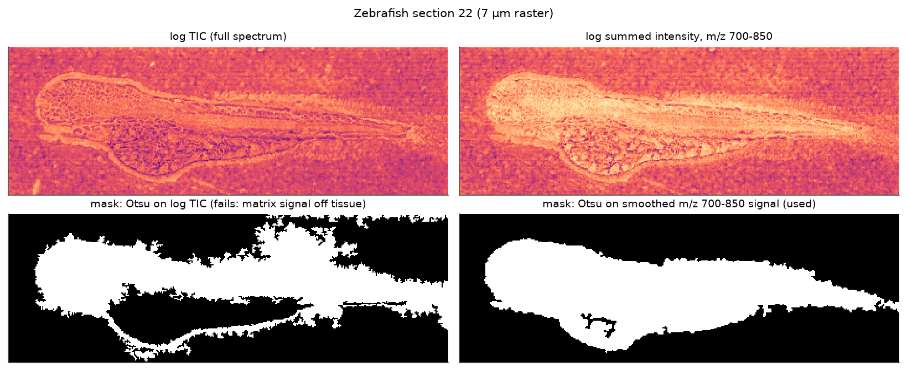
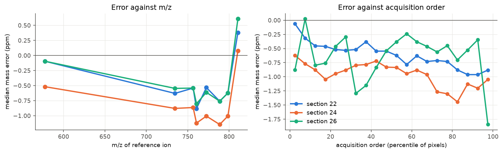
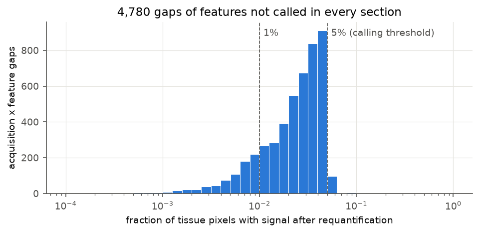
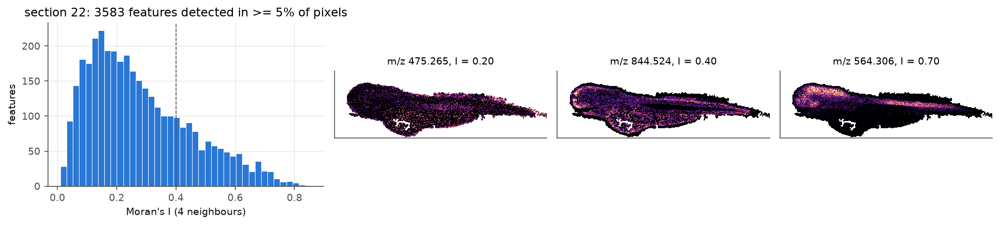
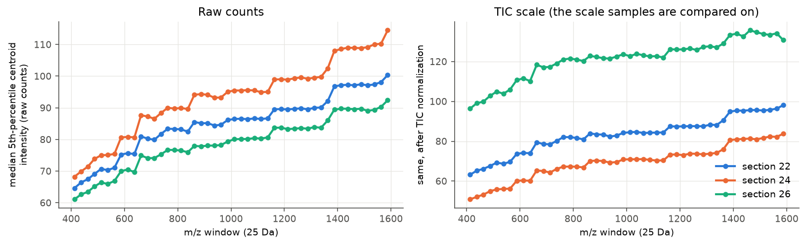
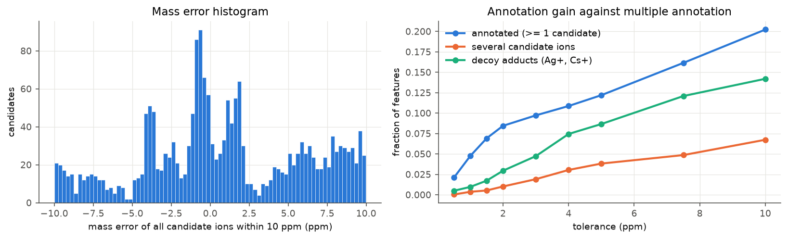

# Tutorial for MALDI mass spectrometry imaging (spatial lipidomics) data preprocessing and analysis
#### Draft compiled on 27 Sep 2026, revised on 26 Oct 2026
### Table of Contents
  * [Introduction](#introduction)
  * [Preparation](#preparation)
    * [1-1. What an MSI data set is, and why it is not "just another omics matrix"](#1-1-what-an-msi-data-set-is-and-why-it-is-not-just-another-omics-matrix)
    * [1-2. Computing resources](#1-2-computing-resources)
    * [1-3. Data formats: vendor raw files and imzML](#1-3-data-formats-vendor-raw-files-and-imzml)
    * [1-4. Install the required tools with conda](#1-4-install-the-required-tools-with-conda)
    * [1-5. Get public MALDI-MSI data](#1-5-get-public-maldi-msi-data)
  * [Preprocessing of MALDI-MSI data](#preprocessing-of-maldi-msi-data)
    * [2-1 Conversion to imzML](#2-1-conversion-to-imzml)
    * [2-2 Quality control of individual acquisitions and tissue masks](#2-2-quality-control-of-individual-acquisitions-and-tissue-masks)
    * [2-3 Peak calling (image extraction)](#2-3-peak-calling-image-extraction)
    * [2-4 Matching features across acquisitions](#2-4-matching-features-across-acquisitions)
    * [2-5 Feature quality control](#2-5-feature-quality-control)
    * [2-6 Intensity normalization and batch effects](#2-6-intensity-normalization-and-batch-effects)
    * [2-7 Registration to a reference atlas](#2-7-registration-to-a-reference-atlas)
    * [2-8 Lipid annotation](#2-8-lipid-annotation)
    * [2-9 Building the pixel-by-lipid matrix](#2-9-building-the-pixel-by-lipid-matrix)
  * [Analysis of spatial lipidomics data](#analysis-of-spatial-lipidomics-data)
    * [3-1 Feature selection](#3-1-feature-selection)
    * [3-2 Dimensionality reduction and data integration](#3-2-dimensionality-reduction-and-data-integration)
    * [3-3 Clustering and spatial segmentation](#3-3-clustering-and-spatial-segmentation)
    * [3-4 Imputation of sparsely detected lipids (and why to be careful)](#3-4-imputation-of-sparsely-detected-lipids-and-why-to-be-careful)
    * [3-5 Characterizing lipid territories](#3-5-characterizing-lipid-territories)
    * [3-6 Comparing conditions](#3-6-comparing-conditions)
    * [3-7 3D reconstruction and visualization](#3-7-3d-reconstruction-and-visualization)
    * [3-8 Other analysis](#3-8-other-analysis)
  * [Appendix A. The Lipid Brain Atlas pipeline as it was actually run](#appendix-a-the-lipid-brain-atlas-pipeline-as-it-was-actually-run)
  * [Appendix B. How other published MALDI pipelines differ](#appendix-b-how-other-published-maldi-pipelines-differ)
  * [References](#references)


## Introduction
<sub><a href="#top">(Back to top)</a></sub></br>
Mass spectrometry imaging (MSI) records a full mass spectrum at every position ("pixel") of a thin tissue section. For each detected ion, this gives an image of where it is in the tissue. Matrix-assisted laser desorption/ionization (MALDI) is the most common ionization technique for this purpose. The section is coated with a small organic "matrix" compound and a laser is fired at one position after the other. The matrix absorbs the laser energy, material from the tissue is desorbed and partly ionized, and the mass spectrometer records the mass-to-charge ratios (m/z) of the ions. With matrices commonly used for lipids (e.g. DHB in positive mode) and an m/z range of ~400-1,200, most ions detected in brain tissue are membrane lipids (phosphatidylcholines, phosphatidylethanolamines, sphingomyelins, (hexosyl)ceramides, phosphatidylserines, etc.). This is why MALDI-MSI is often called *spatial lipidomics*.

As with RNA-seq, the raw data are not yet biological results. What you get is, for every pixel, a list of (m/z, intensity) pairs. You need to turn these into a pixel-by-molecule matrix, make intensities comparable across tissue sections, figure out which molecule each m/z value corresponds to, place the sections into a common coordinate system, and only then start the analysis, for example clustering pixels into lipid-defined territories or comparing conditions.

This tutorial walks through all these steps. It is built around the pipeline used in the recent mouse brain Lipid Brain Atlas (LBA) paper by the La Manno and D'Angelo labs (Fusar Bassini, Schede et al., *Nature* 2026), because its code and data are public and because it represents the current "single-cell-genomics-style" way of analyzing MSI data: peak calling with uMAIA, joint normalization of >100 sections, registration to the Allen Common Coordinate Framework (CCF), NMF embedding, Harmony integration, hierarchical clustering into "lipizones", label transfer and case-control modelling with the EUCLID package. For every step I also describe open-source alternatives (Cardinal, MALDIquant, METASPACE, msiFlow, MetaVision3D-style processing, internal-standard quantification) and what the other large MALDI studies did, so that you can make informed choices for your own data. Commercial tools (SCiLS Lab, LipostarMSI, MetaboScape) are only mentioned where they are, in practice, hard to avoid.

The LBA is one particular experimental design, and several of its steps only make sense for that design. Two designs are common, and the tutorial gives both versions wherever a step depends on the design:
* **Serial sections** of one or a few stereotyped organs (the LBA, the uMAIA zebrafish atlas, MetaVision3D). Consecutive sections should look alike, which can be exploited for feature filtering and normalization, and sections can be registered to a reference atlas.
* **Independent samples**: sections of different animals, patients, biopsies, organoids, tumours or other non-stereotyped tissues, often several samples per slide and per acquisition run. Each sample is a biological unit, there is no "neighbouring section" that should look the same, usually no atlas, and differences between samples are typically what one wants to measure.

Throughout the tutorial, I also point out where the LBA *code* differs from what the LBA *Methods* say, and where their choices are risky for particular questions. These are not meant as a take-down of the paper but as a lesson: many of the decisions in an MSI pipeline silently decide what you can and cannot conclude later.

>**NOTE**
>* This tutorial assumes basic familiarity with Linux/Bash, SSH and HPC job schedulers, conda, Python and R. If you need a refresher, sections 1-1 to 1-4 of the [RNA-seq tutorial](https://github.com/quadbio/RNAseq_tutorial) cover exactly these basics and are not repeated here.
>* All code was written against the package versions listed in section 1-4. MSI software is much less mature than RNA-seq software, and APIs change. If something does not run, check the version first.

## Preparation
<sub><a href="#top">(Back to top)</a></sub></br>

### 1-1. What an MSI data set is, and why it is not "just another omics matrix"
<sub><a href="#top">(Back to top)</a></sub></br>
It is tempting to treat MSI data as "spatial transcriptomics with lipids instead of genes". Several properties make it rather different, and each of them corresponds to a preprocessing step later.

| Property | RNA-seq / spatial transcriptomics | MALDI-MSI | Consequence |
|---|---|---|---|
| Feature identity | A read maps to a gene with a stable ID | A peak is an m/z value that drifts by a few ppm between pixels and runs, and can correspond to several isobaric molecules or adducts | Peak calling and cross-section matching (2-3, 2-4) and annotation (2-8) are needed before you even have features |
| Signal scale | Counts; proportional to molecule number | Ion intensity; depends on ionization efficiency, matrix, local tissue composition ("ion suppression"), laser power, detector | Intensities of different lipids cannot be compared with each other. After normalization (2-6), the same lipid can be compared across pixels in relative terms only, and regional differences in ion suppression can remain |
| Batch unit | Library / sequencing lane | Technical variation is hierarchical: sample preparation batch and slide, acquisition run (one or several sections or samples, measured over hours to days), day and instrument period, and positions within a run | Record every level and decide per analysis which one is the batch; it is not automatically the section (2-6, 3-2) |
| Missingness | Zeros mostly reflect low expression | A zero can mean absent, below detection, masked or off-tissue, and a lipid can "drop out" of an entire acquisition due to matrix/instrument conditions | Keep these cases apart; filter or model them, and impute only for visualization (2-5, 3-4) |
| Spatial resolution | From 0.5 µm (imaging-based) to 55 µm (spot-based) | Laser spot 1-100 µm, raster step 5-100 µm. A pixel is a sampling position, not a cell: at 5-10 µm it covers part of a cell, at 100 µm many cells. Analyte delocalization during preparation further limits the effective resolution | Clusters are mixtures of cell bodies, processes and extracellular material, not cell types |
| Polarity | Not applicable | Positive and negative ion modes detect different lipid classes | A single-polarity data set misses whole classes (positive mode favours e.g. PC, SM and neutral-lipid adducts; negative mode e.g. PI, PS, PE and sulfatides) |
| Isomers | Not applicable | MS1 cannot distinguish isomers (e.g., PC 16:0_18:1 vs PC 18:0_16:1, both PC 34:1); in-source fragments can mimic other classes | Report sum composition (e.g., "PC 34:1") and support critical identities by MS/MS or LC-MS, stating the structural level reached |

Most of the pitfalls discussed later come from forgetting one of these rows.

### 1-2. Computing resources
<sub><a href="#top">(Back to top)</a></sub></br>
MSI raw data are large. A single coronal mouse brain section acquired on an Orbitrap at 25 µm with a 240k resolving power (as in the LBA) produces a Thermo `.RAW` file of 7-22 GB, and the 120 LBA acquisitions add up to more than 1 TB of raw data. After peak calling the data become manageable (the LBA pixel-by-feature table with ~7 million pixels is ~9 GB as parquet), but several steps are still demanding:

| Step | Tool | Rough requirements |
|---|---|---|
| Peak calling | uMAIA | Per section: a few GB to tens of GB RAM (it loads the full centroided spectra as a sparse matrix); parallel over m/z chunks |
| Matching | uMAIA + Gurobi | CPU-bound; a full (non size-restricted) Gurobi license for > few sections |
| Normalization | uMAIA (JAX/NumPyro) | Runs on CPU; a GPU helps. JAX pre-allocates 75-90% of GPU memory unless you set `XLA_PYTHON_CLIENT_PREALLOCATE=false` |
| Moran's I per feature per section | squidpy | Hours for ~1,400 features x 138 sections |
| Hierarchical clustering | EUCLID | ~24 h for 1.5 million pixels, ~2 h for 300k pixels (EUCLID tutorial numbers) |
| Feature restoration | EUCLID/XGBoost | Several hours |
| Registration | ABBA (Fiji, GUI), STalign (PyTorch) | A desktop with a display for ABBA; STalign benefits from a GPU |

In practice: do conversion and peak calling on a Linux server or HPC (one job per section), and do registration with ABBA on a workstation. Using an HPC and the SLURM scheduler works exactly as described in section 1-3 of the RNA-seq tutorial; an example job script for peak calling is given in section 2-3. Small data sets (a few acquisitions of up to ~100,000 pixels each, i.e. ~1 GB of imzML per acquisition) can be processed entirely on a laptop.

### 1-3. Data formats: vendor raw files and imzML
<sub><a href="#top">(Back to top)</a></sub></br>
Each instrument writes its data in the vendor's own format, which most analysis tools cannot read, so the data are converted to an open format before processing. It helps to know what that format contains, because several practical problems later (slow reading, file names, misleading metadata) come from it. Every vendor has its own raw format:

| Vendor / instrument | Raw format | Notes |
|---|---|---|
| Thermo Orbitrap (Q Exactive, Exploris) with a MALDI source, e.g. TransMIT AP-SMALDI5 (used in the LBA) | `.RAW` (spectra) + `.UDP` (the source's pixel/position information) | Both files are needed to reconstruct the image |
| Bruker timsTOF fleX / rapifleX / solariX | `.d` folder (`.tsf` for MALDI without ion mobility, `.tdf` with TIMS) | TIMSCONVERT can read it (Windows/Linux only; the Bruker SDK does not support macOS) |
| Waters (DESI/MALDI SYNAPT) | `.raw` folder | Usually exported to imzML with the vendor's HDI software |

The community standard to exchange MSI data is [imzML](https://ms-imaging.org/imzml/). An imzML data set consists of two files with the same name: a small XML file (`.imzML`) with metadata and, for each pixel, its (x, y) coordinate and the byte offsets of its spectrum, and a binary file (`.ibd`) with the actual m/z and intensity arrays. Two flavours exist:
* **continuous**: all pixels share the same m/z axis (typical for profile data or data binned onto a common grid)
* **processed**: each pixel has its own m/z array (typical for centroided Orbitrap/FT-ICR data, and what you get from the LBA data sets)

And spectra can be **profile** (the full peak shape) or **centroid** (one m/z value per peak). uMAIA expects centroided data.

You can inspect any imzML file in Python with [pyimzML](https://github.com/alexandrovteam/pyimzML):

```python
from pyimzml.ImzMLParser import ImzMLParser, getionimage
import numpy as np

p = ImzMLParser("section01.imzML")          # the .ibd file must be next to it
print(len(p.coordinates), "pixels")        # list of (x, y, z) tuples, 1-based
mzs, ints = p.getspectrum(0)                # spectrum of the first pixel
print(len(mzs), mzs[:5], ints[:5])

# a quick ion image: PC 34:1 [M+K]+ at m/z 798.5410, +/- 5 ppm
mz = 798.5410
z = p.coordinates[0][2]                     # getionimage defaults to z=1; pass the plane explicitly
img = getionimage(p, mz, tol=mz * 5e-6, z=z) # tol is absolute (m/z units): 5 ppm of mz
```

>**NOTE**
>* If `getspectrum` is slow for your data, it is because processed imzML stores a separate m/z array per pixel. For anything beyond quick looks, use a tool that reads the file once into a sparse matrix (uMAIA, Cardinal, M2aia).
>* File extensions are case-sensitive on Linux. Converters write `.imzML`/`.ibd`, `.imzml`/`.IBD` or other variants; the uMAIA command line script expects exactly `.imzml` and `.IBD`. Rename consistently before processing.
>* Do not rely blindly on the metadata. RAW2IMZML, for example, declares "centroid spectrum" in the file description but "profile spectrum" in the spectrum parameter group of the same file. Check the spacing of consecutive m/z values in a few spectra (centroid data: irregular, mostly > 1 mDa; profile data: dense and regular) and tell your reader explicitly what the data are if it guesses wrong.
>* One acquisition run often covers several regions (several samples on one slide), which are exported as separate imzML files. Keep track of which samples were acquired in the same run, because samples of one run share its acquisition conditions (2-6).

### 1-4. Install the required tools with conda
<sub><a href="#top">(Back to top)</a></sub></br>
Unlike in the RNA-seq world, most MSI tools are Python or R packages with strongly pinned dependencies, and they often conflict with each other. I therefore recommend **four separate environments**. The environment files are in the [`envs/`](envs/) folder of this repository. Please install [Miniforge](https://github.com/conda-forge/miniforge) (which provides `conda` and the much faster `mamba`) as described in section 1-4 of the RNA-seq tutorial.

| Environment | Purpose | Key packages |
|---|---|---|
| `msi-umaia` | Peak calling, matching, normalization | uMAIA (Python 3.11.3, JAX 0.4.14, NumPyro 0.12.1, gurobipy 10.0.2) |
| `msi-euclid` | Feature selection, NMF, Harmony, lipizones, restoration, case-control | euclid-msi 0.0.6 (Python 3.10; pins scanpy 1.10.3, squidpy 1.5.0, harmonypy 0.0.9, xgboost 1.7.6, numpyro 0.16.1 ...) |
| `msi-analysis` | QC, registration (STalign, DeepSlice), annotation helpers (METASPACE client, goslin, LINEX2), general analysis | recent scanpy/squidpy/napari, PyTorch |
| `msi-r` | Alternative pipeline in R | Cardinal 3 (Bioconductor), MALDIquant |

#### uMAIA
The uMAIA README asks for a very specific installation order. Follow it exactly, otherwise `numcodecs`/`scikit-image` build issues are likely:

```console
mamba create -n msi-umaia python==3.11.3 -y
conda activate msi-umaia
pip install -U pip==25.1.1 setuptools==80.9.0 wheel==0.45.1
pip install --only-binary=:all: --no-cache-dir numcodecs==0.12.0
pip install py-cpuinfo==9.0.0
pip install cython==3.1.2

git clone https://github.com/lamanno-epfl/uMAIA.git
cd uMAIA
git checkout fc5e495c495cac6ab4d1d9e01208c7ca52c10e18   # the commit this tutorial was tested with (Oct 2026)
# uMAIA pins jaxlib==0.4.14, which has been removed from PyPI; Google's JAX archive still has it
pip install --no-build-isolation --no-cache-dir -e . \
    -f https://storage.googleapis.com/jax-releases/jax_releases.html
pip install -U --no-deps scikit-image==0.22.0 lazy_loader==0.4
```

>**NOTE**
>Without the `-f` line, the installation fails on every OS with "No matching distribution found for jaxlib==0.4.14". The command above was tested on macOS (Apple Silicon), most recently in October 2026 at the commit given above; the archive also has the Linux x86_64 and Intel macOS wheels. uMAIA has no releases, and later sections call one of its private functions, so stay on this commit unless you have a reason to update (see "Version-sensitive calls").

The `-e` (editable/developer) installation means that the package is imported from the cloned folder, so you can read and modify the source code, which you will want to do at some point (see Appendix A).

uMAIA's cross-section matching solves an integer program with **Gurobi**, a commercial solver. This is the one place in the pipeline where a commercial tool is required (unless you replace the matching step, see 2-4). Gurobi is free for academic use:
1. Register at [gurobi.com](https://www.gurobi.com) with your institutional e-mail and request a *Named-User Academic* license. You get a license key.
2. The `gurobipy` pip wheel installed with uMAIA already includes the solver, but only with a size-restricted license (2,000 variables/constraints), which is not enough for real data. To activate the full license you need the `grbgetkey` tool, which comes with the full Gurobi installation ([download](https://www.gurobi.com/downloads/); the uMAIA README uses version 9.1.2):
   ```console
   tar -xzvf gurobi9.1.2_linux64.tar.gz
   gurobi912/linux64/bin/grbgetkey <your-license-key>    # must be run from within the university network
   ```
   This writes `gurobi.lic` into your home folder, which `gurobipy` finds automatically. On an HPC, a floating/WLS license may be more practical; ask your IT.

If you plan to run the normalization on a GPU, install the CUDA build of `jaxlib` matching JAX 0.4.14 and set
```console
export XLA_PYTHON_CLIENT_PREALLOCATE=false
```
before starting Python.

#### EUCLID
```console
mamba env create -f envs/msi-euclid.yml
conda activate msi-euclid
python -m ipykernel install --user --name msi-euclid --display-name "Python (msi-euclid)"
```
EUCLID pins its direct dependencies but not theirs, and a plain `pip install euclid-msi==0.0.6` today installs a combination in which `import euclid_msi` fails (old `xarray-dataclasses` pulled in via squidpy/spatialdata, `imbalanced-learn` incompatible with the installed scikit-learn, and `pkg_resources` missing from recent setuptools). The environment file therefore installs EUCLID with the constraints file [`envs/euclid-constraints.txt`](envs/euclid-constraints.txt), which fixes all versions to a combination that imports cleanly. If you install with pip directly:
```console
pip install euclid-msi==0.0.6 tables -c envs/euclid-constraints.txt
```
Note also that the first `import euclid_msi` downloads EUCLID's reference files (lipid class colours, HMDB, structures) from Zenodo, so the first import needs internet access.

EUCLID is, in the words of its README, "still very much work in progress and just partially tested". It was tested on Linux and partially macOS, not Windows. Read its source code before trusting a function you depend on (Appendix A lists one important case).

#### The general analysis environment and the R environment
```console
mamba env create -f envs/msi-analysis.yml
conda activate msi-analysis
# STalign's own requirements pin numpy==1.23.4 and PIMS==0.3.0, which cannot be installed
# on Python 3.12; install it without dependencies (everything it needs is already in the environment)
pip install --no-deps git+https://github.com/JEFworks-Lab/STalign.git
# STalign 2.0 changed default settings; to reproduce results obtained with 1.x (e.g. the LBA), install the tag instead:
# pip install --no-deps git+https://github.com/JEFworks-Lab/STalign.git@v1.0.1   (see "Version-sensitive calls")
```

For R on **Linux** or an **Intel Mac**:
```console
mamba env create -f envs/msi-r.yml
conda activate msi-r
R -e 'BiocManager::install("CardinalWorkflows")'
```
On an **Apple Silicon Mac**, `envs/msi-r.yml` does not solve, because bioconda has no arm64 build of `bioconductor-cardinalio`, which Cardinal depends on. Remove the `bioconductor-cardinal` line from the file (or use R from [CRAN](https://cran.r-project.org)), then install Cardinal from Bioconductor, which provides arm64 binaries:
```console
R -e 'BiocManager::install(c("Cardinal", "CardinalWorkflows")); install.packages(c("MALDIquant", "MALDIquantForeign"))'
```

#### Which operating system?
All four environments were test-solved for macOS on Apple Silicon (arm64), macOS on Intel (x86_64) and Linux (x86_64); `msi-umaia`, `msi-euclid`, `msi-analysis` and Cardinal were also installed and imported on an Apple Silicon Mac. Windows was not tested.

| Environment / tool | Linux x86_64 | macOS arm64 | macOS x86_64 | Notes |
|---|---|---|---|---|
| `msi-umaia` | Resolves | Installed and tested | Resolves | Needs the JAX archive (`-f` above) on all systems; Gurobi licence on all systems |
| `msi-euclid` | Resolves | Installed and tested | Resolves | Needs `euclid-constraints.txt` on all systems; `brotlipy` is compiled from source on Apple Silicon (install Xcode command line tools: `xcode-select --install`) |
| `msi-analysis` | Resolves | Installed and tested | Resolves, with older packages | STalign with `--no-deps` on all systems; on Intel Macs pip falls back to TensorFlow 2.16 and PyTorch 2.2 (the last releases for that platform) |
| `msi-r` | Resolves | **Fails via bioconda**; Cardinal 3.14 via `BiocManager` tested | Resolves | See above |
| RAW2IMZML | No | No | No | Windows only |
| TIMSCONVERT | Yes | No | No | The Bruker SDK does not support macOS |
| ABBA (Fiji) | Yes | Not tested | Not tested | Fiji itself runs on all three |
| GPU acceleration (JAX, PyTorch) | CUDA | Not used by uMAIA/STalign (they run on CPU) | No | Only relevant for large data sets |

In practice: everything except the vendor converters works on both Linux and macOS, but the full-size LBA-scale processing (hundreds of GB, days of CPU) belongs on a Linux server or HPC, where CUDA GPUs are also available.

#### Version-sensitive calls
Several calls in this tutorial behave differently, or fail, depending on the installed version. The table lists those known at the time of writing and what to change. Record the versions you actually used (`pip freeze > versions.txt`, `conda env export > env.yml`, `git -C <repo> rev-parse HEAD` for packages installed from GitHub, `sessionInfo()` in R), and pin GitHub installs to a commit or tag (`pip install git+https://github.com/<org>/<repo>.git@<tag-or-commit>`).

| Package | Call (section) | What changes between versions | What to do |
|---|---|---|---|
| uMAIA | `uMAIA.peak_finding._run.save_images` (2-3) | Private function of a package without releases; it can be renamed or moved | Use the commit pinned in the install block (`fc5e495c`); after an update, locate it with `grep -rn "def save_images" uMAIA/` |
| squidpy | `sq.gr.spatial_neighbors(..., coord_type="grid")` (2-5) | Deprecated since 1.7 and announced for removal in 1.9, replaced by `sq.gr.spatial_neighbors_grid`. The grid default is `n_neighs=6` (hexagonal Visium spots); on a square MSI raster the built-in distance correction gives 4 neighbours (tested with 1.8.3), but this is implicit | Always pass `n_neighs=4` (rook) or `n_neighs=8` (queen) explicitly; with squidpy >= 1.7 use `sq.gr.spatial_neighbors_grid(ad, n_neighs=4)`. EUCLID 0.0.6 pins squidpy 1.5.0 |
| STalign | `STalign.LDDMM`, `transform_points_source_to_target` (2-7) | Version 2.0 (Oct 2026) keeps the API (the result is still a dict with `"A"`, `"v"`, `"xv"`) but changes defaults: affine pre-fit, `sigmaR` and step sizes chosen from the data, `niter` 2000 by default, exact inverse for source-to-target transforms. Results differ from 1.0 | To reproduce 1.x results (e.g. the LBA): `LDDMM(..., legacy_defaults=True)` and `transform_points_source_to_target(..., exact_inverse=False)`, or install `@v1.0.1`. The unpinned install command in this section gets the newest version |
| scanpy | `sc.tl.leiden(..., flavor="igraph", n_iterations=2)` (3-3) | `flavor` exists from scanpy 1.10; the default backend is moving from `leidenalg` to `igraph` | With scanpy < 1.10 drop `flavor` and `n_iterations`; set `random_state` in all versions |
| scanpy | `sc.pp.combat(..., covariates=...)` (2-6) | Tested with 1.12: categorical covariates are coded with one column per level next to one column per batch, which makes the design singular | Pass covariates as numeric 0/1 columns, e.g. from `formulaic.model_matrix("~ condition", meta)` without the intercept |
| harmonypy | `run_harmony(...).Z_corr` (3-2) | Orientation (components x cells or cells x components) differs between versions | Check the shape against `(n_obs, n_components)` as in the code of 3-2 |
| zarr | `uMAIA.ut.tools.to_zarr`, `to_zarr_normalised` (2-4, 2-6); reading the stores (2-5, 2-9) | uMAIA writes with the zarr 2 API (`create_dataset`), which zarr 3 removed; uMAIA pins zarr 2.16.0, EUCLID's constraints 2.14.2, `msi-analysis` is unpinned (zarr 3) | Write the stores in `msi-umaia`. Reading them (`zarr.open`, `group_keys()`, `array_keys()`) works with both zarr 2 and 3. SpatialData (2-9) requires zarr 3, so keep it in `msi-analysis` |
| scikit-image | `remove_small_objects(min_size=)`, `remove_small_holes(area_threshold=)` | Deprecated in 0.26 in favour of `max_size` (which removes objects of size <= instead of <); `max_size` does not exist before 0.26 | The mask code in 2-2 uses `scipy.ndimage`, which is version-independent |
| SciPy / AnnData | `X ** 2`, `X * Y` on sparse matrices (2-6) | For `scipy.sparse` *matrices* (`csr_matrix`, the usual type of `adata.X`) `**` and `*` are matrix power and matrix product; for sparse *arrays* (`csr_array`) they are element-wise | Use `X.multiply(X)` / `X.power(2)` and `X.multiply(Y)`, or convert to dense in chunks |
| pyimzML | `getionimage(p, mz, tol=...)` (1-3, 2-2) | `tol` is an absolute window in m/z units, not ppm | Convert: `tol = mz * ppm * 1e-6` |
| metaspace2020 | `sm.submit_dataset(...)`, `ds.results(...)` (2-8) | Arguments, metadata schema and database names change with the client and server versions | Check `help(sm.submit_dataset)` and `sm.databases()` before submitting |
| euclid-msi | All EUCLID calls (2-8, 2-9, 3-x) | Written for 0.0.6; the package is young and signatures change | Pin 0.0.6 with the constraints file, or check `inspect.signature(...)` of each function in newer versions |
| Cardinal | All Cardinal calls (2-3, 3-3, 3-6) | Written for Cardinal 3; Cardinal 2 has a different data model (no `MSImagingArrays`, no `peakProcess`) | Use Cardinal 3, or follow the Cardinal 2 vignettes |

#### Tools outside conda
* **ABBA** (Aligning Big Brains and Atlases) is a Fiji plugin. Install [Fiji](https://fiji.sc), then *Help > Update... > Manage update sites*, enable `PTBIOP`, restart. Documentation: https://abbadocumentation.readthedocs.io
* **Format converters**: RAW2IMZML (for AP-SMALDI Orbitrap data; distributed by TransMIT together with the AP-SMALDI source, Windows), [TIMSCONVERT](https://github.com/gtluu/timsconvert) (Bruker, `pip install` into its own environment, Windows/Linux).
* **METASPACE** is a web platform; you only need an account at https://metaspace2020.org (the `metaspace2020` Python client is in `msi-analysis`).
* **msiFlow** (an alternative, Snakemake-based, end-to-end workflow collection) runs from Docker: `docker pull phispa1812/msiflow_cli`.

### 1-5. Get public MALDI-MSI data
<sub><a href="#top">(Back to top)</a></sub></br>
Public MSI data mostly live in three places: [METASPACE](https://metaspace2020.org) (imzML plus annotations, >10,000 public data sets), [Zenodo](https://zenodo.org) and PRIDE. For this tutorial we use two data sets.

#### A small data set to learn the tools: the uMAIA zebrafish sections
The uMAIA tutorial data (Zenodo record 8410583) are a few sagittal sections of a 72 hpf zebrafish embryo acquired with the same AP-SMALDI Orbitrap setup as the LBA, at 7 µm. They are small enough for a laptop:

```console
mkdir -p rawData && cd rawData
for s in 20220620_Zebrafish_atlas_72hpf_fish2_section22_420x142_Att35_7um \
         20220620_Zebrafish_atlas_72hpf_fish2_section26_345x136_Att35_7um \
         20220621_Zebrafish_atlas_72hpf_fish2_section24_422x135_Att35_7um; do
  for ext in imzml IBD; do
    wget -nc https://zenodo.org/record/8410583/files/${s}.${ext}
  done
done
cd ..
```

#### The Lipid Brain Atlas
The LBA data are distributed at several levels of processing:

| Level | Where | Size | Use it for |
|---|---|---|---|
| Vendor raw (`.RAW` + `.UDP`) | 26 Zenodo records listed in Supplementary Table 11 of the paper (starting at record 17068820) | 3-22 GB per section, >1 TB total | Full re-processing from scratch |
| imzML (centroided) | METASPACE project `mlba-2025` ("MouseBrainAtlas", 132 data sets) | ~1-3 GB per section | Starting at peak calling; checking METASPACE annotations |
| uMAIA-normalized Zarr subset + metadata | Zenodo 16521812 (13.4 GB) + masks (16524009) + EUCLID reference DBs (15650014) | 13.5 GB | The EUCLID tutorial (sections 3-x) |
| Final pixel table | Zenodo 15379565: `maindata_2.parquet` (9.2 GB), plus `csv.zip`, `mixed.zip` | ~14 GB | Re-analysis of lipizones and all downstream results |
| Peak table (all m/z) | Zenodo 15379499: `peaks.parquet` (49 GB) | 49 GB | Everything that needs unannotated peaks |

>**NOTE**
>METASPACE currently disables downloads of this project via its API (the Python client returns "Download disabled on API. Please use the web interface"). Download individual imzML files from the web interface: open the data set, click on *Download* on the data set page.

To download all files of a Zenodo record, use [zenodo_get](https://github.com/dvolgyes/zenodo_get) (`pip install zenodo_get`, in any environment; tested with 3.1.0). It verifies every file against the checksum Zenodo publishes, deletes damaged files and resumes interrupted downloads:

```console
for rec in 15650014 16524009 16521812; do zenodo_get $rec -o .; done    # EUCLID tutorial inputs
zenodo_get 8410583 -o rawData -g '*fish2_section2[246]*'               # -g selects files, e.g. the zebrafish sections above
```

The same in plain Python, without the extra package (the Zenodo API lists the files of a record with their checksums):

```python
import hashlib, os, requests
from tqdm import tqdm

def download_zenodo(record_id, outdir="."):
    os.makedirs(outdir, exist_ok=True)
    rec = requests.get(f"https://zenodo.org/api/records/{record_id}", timeout=60)
    rec.raise_for_status()
    for f in rec.json()["files"]:
        fn = os.path.join(outdir, f["key"])
        algo, ref = f["checksum"].split(":")                  # e.g. "md5:..."
        if os.path.exists(fn) and os.path.getsize(fn) == f["size"]:
            h = hashlib.new(algo)
            with open(fn, "rb") as fh:
                for chunk in iter(lambda: fh.read(1 << 20), b""):
                    h.update(chunk)
            if h.hexdigest() == ref:
                continue                                      # complete and intact
        h = hashlib.new(algo)
        with requests.get(f["links"]["self"], stream=True, timeout=60) as r, open(fn + ".part", "wb") as out:
            r.raise_for_status()
            for chunk in tqdm(r.iter_content(1 << 20), total=-(-f["size"] // (1 << 20)), desc=f["key"]):
                out.write(chunk); h.update(chunk)
        if h.hexdigest() != ref:
            raise IOError(f"checksum mismatch for {f['key']}")
        os.replace(fn + ".part", fn)

for rec in ["15650014", "16524009", "16521812"]:   # EUCLID tutorial inputs
    download_zenodo(rec)
```

In both cases, then run `tar -xzf LipidAtlas_uMAIA_subset.tar.gz; tar -xzf LipidAtlas_masks.tar.gz`.

## Preprocessing of MALDI-MSI data
<sub><a href="#top">(Back to top)</a></sub></br>
Preprocessing turns the raw spectra into a table that can be analysed: one row per tissue pixel, one column per ion, with intensities that are comparable between pixels and samples, and with a lipid name for each column as far as one can be given. Each step below solves one problem on the way there, which is stated at the start of its section. The overall flow, with the tools used in the LBA and the main open-source alternatives, looks like this:

```
 vendor raw (.RAW/.UDP, .d)
   |  2-1 conversion ............ RAW2IMZML | TIMSCONVERT
 imzML (+ tissue mask, 2-2)
   |  2-3 peak calling .......... uMAIA peak finder | Cardinal peakPick | MALDIquant | targeted m/z list
 per-section image stacks
   |  2-4 cross-section matching  uMAIA + Gurobi | Cardinal peakAlign | ppm clustering | fixed reference m/z list
   |                               + requantification of every feature in every acquisition (gap filling)
   |  2-5 feature QC ............. Moran's I, recurrence (consecutive sections | fraction of samples),
   |                               tissue enrichment, isotopes, adducts
   |  2-6 normalization ......... pixel: TIC/RMS/median/PQN (on QC'd features) | internal standards
   |                               + censoring diagnostic and sensitivity analysis across acquisitions
   |                               cross-sample (slide/run): scaling factor | reference features | reference material
   |                               | model-based batch correction | pseudo-bulk quantile | per-lipid median | uMAIA
   |  2-7 registration .......... ABBA + STalign (Allen CCF) | DeepSlice | section-to-section (ECC)
   |                               (stereotyped organs only; otherwise same-section histology at most)
   |  2-8 annotation ............ ppm matching (tolerance chosen from the data) to LIPID MAPS
   |                               + paired LC-MS/MS | METASPACE FDR
 pixel x lipid matrix (AnnData, 2-9)  --> analysis (section 3)
```

### 2-1 Conversion to imzML
<sub><a href="#top">(Back to top)</a></sub></br>
Vendor raw files can only be read with the vendor's software or libraries, while most open-source MSI tools, including uMAIA, Cardinal and METASPACE, read imzML (1-3). The first step is therefore to convert each acquisition to imzML. It is also the cheapest moment to catch problems: a failed or incomplete conversion, or acquisitions recorded with different settings, should be found before hours of computing are spent on them.

**Thermo AP-SMALDI (LBA setup).** The LBA converted `.RAW`/`.UDP` pairs to imzML with RAW2IMZML v1.0r47 (Windows). The conversion is done per acquisition; conventionally, name the output after the acquisition, which in the LBA encodes date, sample, section, raster size and attenuation, e.g. `20220411_MouseBrain_female_217G_349x316_Att30_25um`. Keep this naming, because uMAIA and EUCLID use the name as the acquisition identifier.

**Bruker timsTOF.** Use TIMSCONVERT (open source, but it bundles the Bruker SDK, so Windows/Linux only):
```console
conda create -n timsconvert python=3.11 -y && conda activate timsconvert
pip install git+https://github.com/gtluu/timsconvert
timsconvert --input /path/to/run.d --outdir imzml/ --mode centroid
```
(See `timsconvert --help` for the imaging-specific options of your version.)

**Other vendors.** Export imzML from the vendor software. If you have mzML with pixel coordinates in a separate file, [imzMLConverter](https://github.com/AlanRace/imzMLConverter) can combine them.

**Check the result.** Before investing hours of compute, check three things: the imzML opens, the number of pixels equals the raster size in the name (e.g. 349 x 316 = 110,284 for a rectangular raster including off-tissue pixels), and a known lipid gives a sensible image (next section). Also compare the acquisition settings in the imzML headers of all acquisitions that will be analysed together. Easily missed differences include the mass range, the resolving power, and whether a lock mass was used for internal calibration (Thermo filter strings `FTMS + p NSI Full lock ms [...]` versus `FTMS + p NSI Full ms [...]`):
```console
grep -H -o 'name="filter string" value="[^"]*"' imzml/*.imzML
grep -H -o 'name="pixel size x" value="[^"]*"' imzml/*.imzML
```
Settings that differ between acquisitions are not necessarily a problem, but they create technical differences that must be checked in 2-2 and handled in 2-6.

### 2-2 Quality control of individual acquisitions and tissue masks
<sub><a href="#top">(Back to top)</a></sub></br>
Every later step treats the acquisitions as comparable measurements of tissue. Problems that are not caught here end up in the results, often in a form that can no longer be recognized. Before peak calling, three questions need an answer for every acquisition:

1. **Did the acquisition work?** Uneven matrix coating, stripes from laser or stage problems, tissue damage (folds, tears) and low ion yield change the intensities in ways that normalization (2-6) cannot undo. Most of these problems are visible in the image of the total ion current (TIC), i.e. the summed intensity of each pixel's spectrum. Exclude acquisitions that fail, or flag them; the LBA excluded "damaged or low MALDI yield" sections and kept a `BadSection` flag in the acquisition metadata.
2. **Are the m/z values accurate?** Matching features across acquisitions (2-4) and annotation (2-8) compare m/z values with tolerances of a few ppm, so a calibration error of 1-2 ppm uses up a large part of the tolerance. The error can be measured with *reference ions*: ions that are abundant in every acquisition and whose exact m/z is known from their formula. In positive mode with DHB, the [M+H]+, [M+Na]+ and [M+K]+ ions of an abundant phosphatidylcholine such as PC 34:1 are a good start. The difference between the observed and the theoretical m/z of these ions, in ppm, is the mass error.
3. **Which pixels are tissue?** The raster is a rectangle that covers the sample and the glass around it. Pixels outside the tissue still have spectra (matrix ions, salt clusters, analytes that spread during matrix application), but they do not measure the tissue. Left in, they lower sample means and detection fractions, enter the normalization (2-6) and distort spatial statistics such as Moran's I (2-5). A *tissue mask*, a boolean image with `True` for tissue pixels, keeps them out of every later step. uMAIA expects one mask per acquisition, as `data/<acquisition>/mask.npy`, with the same shape as the extracted images.

**Choosing reference ions.** A reference ion must have no other ion within a few ppm, otherwise the measured "error" is the distance to the other ion. In positive mode this is a real risk, because sodium adducts fall close to protonated ions of other lipids: "PC 38:6 [M+H]+" (m/z 806.5694) and PC 36:3 [M+Na]+ (m/z 806.5670) are only 3.0 ppm apart, as are "PE 38:4 [M+H]+" (768.5538) and PE 36:1 [M+Na]+ (768.5514). If some reference ions sit at -3 ppm while all others are within 0.5 ppm, you are probably looking at the sodium adduct. Use ions without such near-isobars, spread over the m/z range, and set a minimal intensity so that noise centroids near the reference m/z are not counted as matches.

**Making the tissue mask.** The mask is a threshold on an image in which tissue is brighter than the background; Otsu's method chooses the threshold that best separates the two groups of pixel values. Which image is thresholded matters more than the method. The TIC seems the obvious choice, but it includes the matrix ions, which can be as strong off tissue as on it. Otsu on the TIC then follows matrix patches and misses parts of the tissue (Figure 2-2a, bottom left). An image of signal that comes from the tissue avoids this: the summed intensity in an m/z range dominated by membrane lipids (e.g. m/z 700-850 in positive mode), or the image of one abundant tissue lipid. Light smoothing (a Gaussian with a sigma of one pixel) removes pixel-to-pixel noise before the threshold is applied (Figure 2-2a, bottom right). After thresholding, remove small isolated pieces (noise, matrix crystals) and fill only small holes. Do not fill all holes or keep only the largest piece: many tissues contain cavities without tissue (ventricles, vessels, lumens of glands or organoids), which must stay outside the mask, and one raster can contain several samples or detached tissue pieces. No rule works for every tissue, so always look at the mask next to the TIC and ion images, and correct it by hand where needed (e.g. by drawing in napari).


*Figure 2-2a. Zebrafish section 22 of 1-5 (7 µm raster). Otsu on the full-spectrum TIC (bottom left) follows matrix signal off the tissue and misses parts of the embryo; Otsu on the lightly smoothed summed intensity of m/z 700-850 (bottom right) gives a usable mask, which the other figures use (`scripts/make_figures.py`).*

A minimal QC script with pyimzML that does all three (environment `msi-analysis`):

```python
import os, numpy as np, matplotlib.pyplot as plt
from pyimzml.ImzMLParser import ImzMLParser, getionimage
from skimage.filters import threshold_otsu
from scipy import ndimage as ndi

name = "20220411_MouseBrain_female_217G_349x316_Att30_25um"
p = ImzMLParser(f"imzml/{name}.imzML")
pixel_um = 25                                           # raster step in µm (imzML header: "pixel size x")
z = p.coordinates[0][2]                                 # imaging plane, passed to getionimage below
lipid_range = (700, 850)                                # m/z range dominated by membrane lipids (positive mode)

# 1) TIC image, and the summed intensity in the lipid range for the mask
xs = np.array([c[0] for c in p.coordinates]) - 1
ys = np.array([c[1] for c in p.coordinates]) - 1
tic = np.zeros((ys.max() + 1, xs.max() + 1))
lip = np.zeros_like(tic)
for i, (x, y) in enumerate(zip(xs, ys)):
    mzs, ints = p.getspectrum(i)
    tic[y, x] = ints.sum()
    lip[y, x] = ints[(mzs >= lipid_range[0]) & (mzs <= lipid_range[1])].sum()

# 2) mass accuracy on reference ions (positive mode, DHB): PC 34:1 [M+H]+, [M+Na]+, [M+K]+
refs = {"PC 34:1 +H": 760.5851, "PC 34:1 +Na": 782.5670, "PC 34:1 +K": 798.5410}
min_int = 0          # set a minimal intensity (or S/N) so that noise centroids are not taken as matches
for lab, mz in refs.items():
    errs = []
    for i in range(0, len(p.coordinates), 200):          # every 200th pixel is enough
        mzs, ints = p.getspectrum(i)
        if len(mzs) == 0:
            continue                                     # empty spectrum
        j = np.argmin(np.abs(mzs - mz))
        if abs(mzs[j] - mz) / mz < 20e-6 and ints[j] >= min_int:
            errs.append((mzs[j] - mz) / mz * 1e6)
    if errs:
        errs = np.asarray(errs)
        print(f"{lab}: median error {np.median(errs):.2f} ppm, MAD {np.median(np.abs(errs - np.median(errs))):.2f}, "
              f"detected in {len(errs)} sampled pixels")
    else:
        print(f"{lab}: not detected")

# 3) tissue mask: Otsu threshold on the smoothed log lipid-range signal, remove small pieces, fill only pinholes
sig = np.log1p(ndi.gaussian_filter(lip, 1))
if np.count_nonzero(sig > 0) < 100:
    raise ValueError(f"{name}: (almost) no signal, check the acquisition")
mask = sig > threshold_otsu(sig[sig > 0])
min_piece = int(np.ceil(0.1e6 / pixel_um**2))   # keep tissue pieces >= 0.1 mm^2
max_hole = int(np.ceil(0.01e6 / pixel_um**2))   # fill holes < 0.01 mm^2 (pinholes), not cavities
# skimage.morphology.remove_small_objects / remove_small_holes do the same, but their size arguments changed in
# scikit-image 0.26 (see "Version-sensitive calls"); the few lines of scipy.ndimage below work in every version
lab, _ = ndi.label(mask); size = np.bincount(lab.ravel()); size[0] = 0
mask = (size >= min_piece)[lab]
lab, _ = ndi.label(~mask); size = np.bincount(lab.ravel()); size[0] = 0
mask |= ((size > 0) & (size < max_hole))[lab]
border = np.zeros_like(mask); border[[0, -1], :] = True; border[:, [0, -1]] = True
print("tissue pixels:", mask.sum(), "| on raster border:", np.count_nonzero(mask & border))
os.makedirs(f"data/{name}", exist_ok=True)
np.save(f"data/{name}/mask.npy", mask)

fig, ax = plt.subplots(1, 4, figsize=(16, 4))
ax[0].imshow(np.log1p(tic)); ax[0].set_title("log TIC")
ax[1].imshow(np.log1p(lip)); ax[1].set_title(f"log summed m/z {lipid_range[0]}-{lipid_range[1]}")
ax[2].imshow(getionimage(p, 798.5410, tol=798.5410 * 5e-6, z=z)); ax[2].set_title("m/z 798.541")
ax[3].imshow(mask); ax[3].set_title("tissue mask")
plt.savefig(f"qc_{name}.png", dpi=150)
```

The size limits are in mm², converted to pixels with the raster step, so that they mean the same at different pixel sizes. Adapt them to your samples, and the m/z range to your polarity, matrix and tissue (it should contain abundant tissue ions and few matrix ions).

>**NOTE**
>* Check whether the mask touches the border of the raster (printed above). If it does, the acquisition did not cover the whole sample, which matters for anything computed per sample (sample means, detection fractions, region proportions).
>* Off-tissue pixels are rarely empty: delocalized analytes and matrix-salt adducts (e.g. [M+Na]+ ions with DHB) can be *detected* in nearly every off-tissue pixel while being one to two orders of magnitude weaker than on tissue. When you compare tissue with background (here and in 2-5), compare intensities, not detection rates.
>* The LBA additionally refined masks after registration by removing pixels that map outside the CCF brain volume (2-9).

**Compare acquisitions with each other.** Collect simple per-acquisition summaries over tissue pixels: median TIC, median number of centroids per pixel, the intensity of a few reference ions, and the mass error. Large differences between acquisitions (e.g. a several-fold difference in TIC, or many more centroids per pixel in one run because of a different noise level) are technical until shown otherwise and determine how much the normalization (2-6) has to do.

**Mass calibration.** Whether to recalibrate depends on the observed errors relative to the tolerance you will use for matching and annotation, not on the analyzer type: recalibrate when the systematic error or its drift over m/z, position or acquisition time uses up a material part of that tolerance (a reproducible 1-2 ppm offset matters for sub-ppm annotation). Plot the error of several unambiguous reference ions spanning the mass range against m/z, position and acquisition time (Figure 2-2b); then correct with a constant, linear (in m/z) or position/time-dependent model as the residuals require (Cardinal `recalibrate()`, lock-mass correction during acquisition, or a regression on reference ions), and check the residuals on ions not used for fitting. Do not recalibrate on database matches selected from the same data.


*Figure 2-2b. Median mass error of nine reference ions (PC adducts and the PC 34:1 in-source fragment) in the tissue pixels of the three zebrafish sections, against m/z (left) and acquisition order (right). All sections are offset by about -0.5 to -1 ppm without a consistent drift over the acquisition. The highest ion, PC 36:1 [M+Na]+, deviates upward in all three sections, which points to an unresolved neighbouring ion rather than to calibration (`scripts/make_figures.py`).*

### 2-3 Peak calling (image extraction)
<sub><a href="#top">(Back to top)</a></sub></br>
After conversion, each pixel is a list of centroids (m/z values with intensities), a few hundred to a few thousand per pixel. The same ion gives slightly different m/z values in different pixels, and no two pixels have the same list, so pixels cannot be compared directly. Peak calling groups the centroids into *features*: m/z intervals that each contain one ion. Summing the intensities inside an interval then gives that ion's value in every pixel, i.e. its image. Intervals that are too wide merge different ions; intervals that are too narrow split one ion into several features. The standard approaches are:
* **Fixed binning**: cut the m/z axis into bins of constant width in Da (e.g. 0.01 Da) or in ppm (log-spaced bins whose width in Da grows with m/z, e.g. 5 ppm). Simple, but a molecule whose m/z drifts can be split across bins, and two molecules can share one bin.
* **Peak picking on a mean spectrum**, then extracting intervals around the peaks (Cardinal, MALDIquant, SCiLS).
* **Targeted extraction** of known m/z values (pyimzML `getionimage`, Cardinal reference peaks, vendor software). METASPACE is different: it scores formula + adduct hypotheses (isotope pattern, spatial isotope co-localization, spatial structure) with a target-decoy FDR, see 2-8.
* **uMAIA's adaptive peak calling**, which works on how *often* an m/z value is detected across all pixels rather than on intensities.

#### 2-3-1 Peak calling with uMAIA (LBA pipeline)
For every acquisition, uMAIA:
1. loads the centroided spectra into a sparse pixel x m/z matrix at an m/z resolution of 0.0001;
2. builds a histogram of *detection frequency* (how many pixels have a centroid in each bin; bins of 7 x `mz_resolution`), and smooths it with a Gaussian (`smoothing`);
3. lowers a threshold stepwise from the maximum down to `threshold_count` and records where new separated "islands" appear (a watershed-like seed search). Each seed is extended left and right while the smoothed frequency decreases monotonically and stays above `threshold_count`. Intervals containing more than one seed are discarded;
4. writes the intervals to `ranges.csv` (`min`, `max`, `mz_estimated`, `num_pixels`, ...), and
5. for every interval with >100 detecting pixels, sums the intensities inside the interval per pixel, **divides by the pixel's TIC**, and stores the images in `images.h5ad` (AnnData, pixels x features, with `uns["img_shape"]`).

Interactively (Jupyter, environment `msi-umaia`):

```python
import os, numpy as np, pandas as pd, matplotlib.pyplot as plt
import uMAIA

path_data, path_save = "rawData", "data"
name = "20220620_Zebrafish_atlas_72hpf_fish2_section22_420x142_Att35_7um"
uMAIA.ut.tools.createSaveDirectory(path_save)
uMAIA.ut.tools.createSaveDirectory(os.path.join(path_save, name))

smz = uMAIA.ut.SmzMLobj(f"{path_data}/{name}.IBD", f"{path_data}/{name}.imzml",
                        mz_resolution=1e-4)
smz.load(load_unique_mz=True)

# check the parameters on a narrow m/z window before running everything
PF = uMAIA.vis.plot_freqmz(smz, np.array([620.4, 620.8]), bins=True,
                           smoothing=1., ylim=3000, threshold_count=8.,
                           approximate_interval=0.2, parallelize=True, mz_resolution=1e-4)
for m in PF.data_mz[PF.seeds]:
    plt.vlines(m, 0, 1000, linestyle="--", color="r")

uMAIA.pf.run(directory_path=os.path.join(path_save, name), smz=smz,
             spectrum_range=(400, 1200), threshold_count=8.,
             approximate_interval=0.2, smoothing=1.,
             parallelize=True, saveimages=True)
```

For many sections, use the command line script shipped with uMAIA, which does steps 1-5 with the Orbitrap defaults (`--mzresolution 0.0001 --threshold_count 8 --approximate_interval 0.1 --smoothing 1 --spectrum_range (400,1200)`). It expects `<path_data>/<name>/<name>.imzml` and `<path_data>/<name>/<name>.IBD`, and writes `ranges.csv` and `images.h5ad` into the same folder (there is no separate output argument). The download in 1-5 puts the files directly into `rawData/`, so first move each pair into its own folder:
```console
for f in rawData/*.imzml; do n=$(basename "$f" .imzml); mkdir -p rawData/$n; mv rawData/$n.imzml rawData/$n.IBD rawData/$n/; done
```
The code in 2-4 reads from `data/<name>/`. Either keep the raw files in `data/<name>/` and pass `--path_data data/`, or point `ranges_files` and `images_files` in 2-4 to `rawData/<name>/`. As a SLURM array job, one section per task:

```bash
#!/bin/bash
#SBATCH --job-name=umaia_pf
#SBATCH --array=1-120
#SBATCH --cpus-per-task=8
#SBATCH --mem=64G
#SBATCH --time=12:00:00

source ~/miniforge3/etc/profile.d/conda.sh
conda activate msi-umaia
name=$(sed -n "${SLURM_ARRAY_TASK_ID}p" acquisitions.txt)
python uMAIA/uMAIA/peak_finding/extract_images.py --path_data rawData/ --name "$name"
```

Parameter meaning and how to choose them:

| Parameter | Default (CLI) | Meaning | When to change |
|---|---|---|---|
| `mzresolution` | 0.0001 | Resolution at which centroids are loaded | Coarser (e.g. 0.001) for TOF data |
| `smoothing` | 1 | Gaussian sigma on the frequency histogram (in bins) | Increase (2-3) for lower mass resolution, when peaks are split |
| `threshold_count` | 8 | Minimal detection count for a bin to belong to a peak | Increase for large sections to suppress noise |
| `approximate_interval` | 0.1 | Size (Da) of m/z chunks processed in parallel | Rarely |
| `spectrum_range` | (400, 1200) | m/z range to process | **Set it to your acquisition range.** The LBA acquired m/z 400-1,600 but the CLI default stops at 1,200; whether they changed it is not documented. Note that the CLI declares this argument with `type=tuple`, so `--spectrum_range 400,1600` becomes a tuple of characters; change the default in `extract_images.py` (or call `uMAIA.pf.run()` from Python) instead |

**Raw or TIC-divided images.** uMAIA divides each image by the pixel's TIC *inside* `save_images` (argument `normalization='tic'`), so the images in `images.h5ad` are already TIC-normalized before the uMAIA normalization of 2-6. This is easy to overlook when reading the uMAIA paper. The TIC is computed over the *full* spectrum, including matrix and noise centroids, and `uMAIA.pf.run()` does not let you change this. To normalize later on curated features only (recommended when acquisitions differ in noise level, see 2-6), extract raw (summed, not divided) images: write the intervals first, then the images:
```python
from uMAIA.peak_finding._run import save_images
uMAIA.pf.run(directory_path=os.path.join(path_save, name), smz=smz,
             spectrum_range=(400, 1200), threshold_count=8., approximate_interval=0.2,
             smoothing=1., parallelize=True, saveimages=False)        # ranges.csv only
df_ranges = pd.read_csv(os.path.join(path_save, name, "ranges.csv"), index_col=0)
df_ranges = df_ranges[df_ranges.num_pixels > 100]
save_images(smz, df=df_ranges, filepath=os.path.join(path_save, name, "images_raw.h5ad"),
            normalization=None, clip=100, coordinates=smz.reader.coordinates)
```

>**NOTE**
>* `num_pixels` in `ranges.csv` (and every pixel-count threshold based on it) counts pixels over the whole raster, including off-tissue pixels.
>* `threshold_count` is an absolute count of pixels per m/z bin. Its meaning therefore depends on the size of the sample: 8 is negligible for a 100,000-pixel brain section, but it is a real constraint for a sample of a few thousand pixels, where a lipid restricted to a small structure is detected in only a few dozen pixels. Check region-specific ions with `uMAIA.vis.plot_freqmz` before choosing it.
>* Because the peak finder uses detection frequency, low-intensity but widespread signals are picked up well, while intense but spatially very restricted signals (few pixels) can be missed if they are below `threshold_count`. Check a few known region-specific lipids.

#### 2-3-2 Alternative: Cardinal (R)
[Cardinal 3](https://cardinalmsi.org) is one of the most complete open-source MSI packages. Its standard processing (environment `msi-r`):

```r
library(Cardinal)
msa <- readMSIData("imzml/section01.imzML")          # MSImagingArrays for processed imzML

# queue the processing steps, then peak-pick
msa_pre <- normalize(msa, method = "tic")
msa_pre <- smooth(msa_pre, method = "gaussian")
msa_pre <- reduceBaseline(msa_pre, method = "locmin")
msa_pre <- process(msa_pre)

msa_peaks <- peakPick(msa_pre, method = "filter", SNR = 3)
mse_peaks <- peakAlign(msa_peaks, tolerance = 5, units = "ppm")   # -> MSImagingExperiment
mse_peaks <- subsetFeatures(mse_peaks, freq > 0.05)               # peaks present in >5% of pixels
mse_peaks

# or all in one step, estimating reference peaks on a subsample of pixels
mse_peaks <- peakProcess(msa_pre, method = "diff", SNR = 6, sampleSize = 0.3, filterFreq = 0.02)
```

For high-resolution Orbitrap/FT-ICR centroid data, skip `smooth()` and `reduceBaseline()` (they are for profile spectra) and use a ppm tolerance for `peakAlign` that matches your mass accuracy (3-5 ppm). For data with visible mass drift, `recalibrate()` against reference peaks from `estimateReferencePeaks()` first.

#### 2-3-3 Alternative: MALDIquant (R) and targeted extraction
[MALDIquant](https://strimmerlab.github.io/software/maldiquant/) with MALDIquantForeign (`importImzMl()`) provides the classical pipeline (`transformIntensity`, `smoothIntensity`, `removeBaseline`, `calibrateIntensity(method="TIC")`, `detectPeaks`, `binPeaks`). It was the main open-source comparison in the uMAIA benchmark. For targeted extraction of a predefined m/z list (e.g. from your LC-MS lipidome), pyimzML's `getionimage` with a ppm tolerance, or Cardinal's `peakPick(ref=...)`, are sufficient.

### 2-4 Matching features across acquisitions
<sub><a href="#top">(Back to top)</a></sub></br>
Peak calling is done for each acquisition separately, so each acquisition has its own feature list. The same molecule appears in each list with a slightly different m/z (calibration differences of 1-3 ppm), and some molecules are called in some acquisitions but not in others. Before acquisitions can be analysed together, features of different acquisitions that are the same ion must become one column of the final table. This section does this in two parts: matching the features across acquisitions, and then requantifying every matched feature in every acquisition, so that a feature that was not called in one acquisition still gets a value there.

#### uMAIA matching (LBA pipeline)
uMAIA formulates matching as a network-flow problem: within each 1-Da window, every detection in every acquisition is a node; edges connect detections of nearby acquisitions (in a random order of acquisitions, looking back `NUM_SKIP = ceil(n/2)` acquisitions) whose m/z differ by less than `MAX_DIST`, keeping the `K=3` nearest candidates; the cost of an edge is the m/z difference, and the cost of starting or ending a path is log(number of acquisitions). Gurobi then selects edges so that every detection lies on exactly one path; the connected components of the selected edges are "molecules". This is repeated for several random acquisition orders and the best solution is kept.

```python
import os, numpy as np, pandas as pd, uMAIA

acquisitions = [
    "20220620_Zebrafish_atlas_72hpf_fish2_section22_420x142_Att35_7um",
    "20220621_Zebrafish_atlas_72hpf_fish2_section24_422x135_Att35_7um",
    "20220620_Zebrafish_atlas_72hpf_fish2_section26_345x136_Att35_7um",
]
ranges_files = [os.path.join("data", a, "ranges.csv") for a in acquisitions]
# images.h5ad: uMAIA default, already divided by the full-spectrum TIC (reproduces the LBA; no second TIC step later)
# images_raw.h5ad: raw sums (2-3, "Raw or TIC-divided images"), for pixel-level normalization on curated features in 2-6
image_file = "images.h5ad"
images_files = [os.path.join("data", a, image_file) for a in acquisitions]

df_list = uMAIA.ut.tools.read_files(ranges_files)
df_list = uMAIA.ut.tools.filterSparseImages(df_list, 100)       # drop features detected in < 100 pixels
                                                               # (uMAIA tutorial: 3000; see NOTE below)

df_match = uMAIA.mm.match(MAX_DIST=0.005, df_list=df_list)      # Da; the tutorial value. Function default: 0.1
df_filter = uMAIA.mm.filter_matches(df_match, num_match=1)   # keep every matched feature; recurrence is filtered in 2-5
                                                             # (uMAIA tutorial: len(acquisitions), i.e. found in ALL sections)
df_filter = df_filter.sort_values(["molecule_ID", "section_ix"])
print(df_filter.molecule_ID.nunique(), "molecules")

uMAIA.ut.tools.to_zarr("data/Stack.zarr", acquisitions, df_filter, images_files)   # e.g. Stack_raw.zarr for raw images
```

The resulting Zarr store has one group per matched feature, named by its mean m/z with six decimals, and one 2D array per acquisition inside it, named by the position of the acquisition in the `acquisitions` list: `root["798.540912"]["3"][:]` would be the image of the feature at m/z 798.540912 in the fourth acquisition (list the actual names with `sorted(root.group_keys())`). Note that `to_zarr` looks up each matched feature among the images of an acquisition with a fixed tolerance of 0.005 Da, independent of `MAX_DIST`.

>**NOTE**
>* `filterSparseImages(df_list, 3000)` (the uMAIA tutorial's value) is an absolute threshold (pixels over the whole raster, see 2-3). 3,000 pixels is a small fraction of a mouse brain section, but it is a third or more of a small sample (an organoid, a biopsy, a zebrafish section), and would remove everything that is spatially restricted. Set it relative to the number of tissue pixels of your smallest sample, or leave the filtering to 2-5.
>* `filter_matches(num_match=len(acquisitions))` (the uMAIA tutorial's value) keeps only molecules found in *every* section. For 100+ sections this is too strict; the LBA kept features "present in at least four consecutive sections" and dealt with dropouts later (2-5, 3-4). For independent samples from different conditions it removes exactly the molecules that are specific to one condition. Use a low `num_match` here and apply the recurrence filter of 2-5, which can take the design into account.
>* `MAX_DIST` is in Da, not ppm: 0.005 Da is 12.5 ppm at m/z 400, ~6 ppm at m/z 800 and ~4 ppm at m/z 1,200. Choose it from the spread of residual mass errors after recalibration (2-2) at the high end of your m/z range, not from the median mass error alone; peak width and unresolved interferences also widen the spread.
>* All acquisitions that are matched together also define the "universe" for normalization (2-6). The LBA matched and normalized 138 acquisitions together, including 13 sections from two other projects (GBA1 and CERT1 mouse brains) that are not part of the paper (see Appendix A).

#### Alternatives
* **Cardinal**: read all sections into one `MSImagingArrays` (`readMSIData` on each file, then `combine()`), run `peakProcess()` on the combined object so that reference peaks are estimated jointly, or `peakAlign()` with a common tolerance.
* **ppm clustering of peak centres**: with a handful of acquisitions and good mass accuracy (measured in 2-2), matching is a simple one-dimensional problem and does not need an integer program or a Gurobi license. In R, `MALDIquant::binPeaks()` and Cardinal's `peakAlign()` do this grouping; Python has no commonly used function for it, so here it is in a few lines. Pool the peak centres of all acquisitions, sort them, and start a new feature wherever two neighbouring centres are more than a tolerance apart:
  ```python
  import numpy as np, pandas as pd

  def match_ppm(df_list, acquisitions, ppm=3):
      """df_list: per-acquisition ranges.csv tables (column mz_estimated)."""
      pk = pd.concat([d.assign(acq=a)[["mz_estimated", "min", "max", "acq"]]
                      for d, a in zip(df_list, acquisitions)])
      pk = pk.sort_values("mz_estimated").reset_index(drop=True)
      gap = np.diff(pk.mz_estimated.values) / pk.mz_estimated.values[1:] * 1e6
      pk["feature"] = np.concatenate([[0], np.cumsum(gap > ppm)])
      # a feature must not contain two peaks of the same acquisition
      n_dup = pk.groupby("feature").acq.apply(lambda a: a.duplicated().any()).sum()
      # single linkage can chain: report features wider than twice the tolerance
      span = pk.groupby("feature").mz_estimated.agg(lambda m: (m.max() - m.min()) / m.mean() * 1e6)
      print(pk.feature.nunique(), "features;", n_dup, "contain >1 peak of one acquisition;",
            (span > 2 * ppm).sum(), "span more than", 2 * ppm, "ppm")
      return pk
  ```
  This is single-linkage clustering, so chains of peaks can merge when many acquisitions are pooled or the tolerance is too wide. The number of features containing two peaks of the same acquisition tells you when this happens: lower the tolerance until it is (almost) zero, and inspect features whose span exceeds twice the tolerance. Complete-linkage clustering with a maximal span, or assignment of peaks to reference m/z values with at most one peak per acquisition, avoids chaining altogether. For dozens of acquisitions or worse mass accuracy, use uMAIA or Cardinal.
* **Reference-list approach**: define the feature list externally (for example, all [M+H]+, [M+Na]+, [M+K]+ ions of lipids detected by LC-MS/MS in the same tissue, within 5 ppm) and extract exactly these intervals in every section. It needs no solver and makes features identical by construction, at the cost of missing unexpected molecules. For lipidomics of a well-characterized tissue it is a reasonable choice.

#### Requantifying every feature in every acquisition (gap filling)
After matching, a feature that was not called in some acquisition has no value there: in uMAIA's Zarr store the array is simply missing. Such gaps are mostly not absences. Peak calling uses a detection-frequency threshold, so a lipid present in only a few percent of the pixels of one acquisition is often not called there although its signal is in the spectra. Treating the gap as zero makes the lipid look absent; treating it as missing drops it from every comparison involving that acquisition.

The remedy is the same as in multi-sample scATAC-seq (call peaks per sample, merge them into a consensus peak set, then count fragments in every consensus peak for every cell of every sample) and in LC-MS ("gap filling" in XCMS or MZmine). Define one m/z interval per feature and acquisition, and re-extract the intensities of *all* features from *every* acquisition's spectra. Afterwards there are no unmeasured blocks: a zero only means "no centroid in this pixel", and the recurrence filter of 2-5 decides which features are reproducible.

Two differences from scATAC-seq matter. First, the m/z axis drifts between acquisitions by 1-3 ppm. Where a feature was not called, its interval is therefore the consensus interval shifted by the acquisition's calibration offset (recalibrating first, 2-2, is better still). Second, merging overlapping intervals can join distinct ions (near-isobars a few mDa apart). Intervals are therefore kept as narrow as the peak widths allow, and overlapping intervals are cut between the feature centres rather than merged.

```python
import warnings
import numpy as np, pandas as pd, anndata as ad, scipy.sparse as sp
from pyimzml.ImzMLParser import ImzMLParser


def consensus_intervals(matches, acquisitions, pad_ppm=1.0):
    """One m/z interval per feature and acquisition.

    matches: one row per (feature, acquisition) in which the feature was called, with columns
             feature, acq, min, max, mz_estimated.
    Called: the acquisition's own interval. Not called: median centre and width of the called
    acquisitions, widened by pad_ppm and shifted by the acquisition's calibration offset.
    Overlapping intervals are cut at the midpoint between the neighbouring feature centres.
    """
    m = (matches.groupby(["feature", "acq"], as_index=False)
                .agg(min=("min", "min"), max=("max", "max"), mz_estimated=("mz_estimated", "median")))
    centre = m.groupby("feature").mz_estimated.median()
    m["dev_ppm"] = (m.mz_estimated / m.feature.map(centre) - 1) * 1e6
    offset = m.groupby("acq").dev_ppm.median()                         # calibration offset per acquisition
    half_ppm = ((m["max"] - m["min"]) / 2 / m.mz_estimated * 1e6).groupby(m.feature).median()

    full = pd.MultiIndex.from_product([centre.index, acquisitions], names=["feature", "acq"]).to_frame(index=False)
    full = full.merge(m[["feature", "acq", "min", "max"]], on=["feature", "acq"], how="left")
    full["called"] = full["min"].notna()
    mid = full.feature.map(centre) * (1 + full.acq.map(offset).fillna(0).values * 1e-6)
    w = (full.feature.map(half_ppm) + pad_ppm) * 1e-6 * mid
    full["min"] = full["min"].fillna(mid - w)
    full["max"] = full["max"].fillna(mid + w)
    full["mz"] = full.feature.map(centre)
    out = []
    for a, g in full.groupby("acq", sort=False):
        g = g.sort_values("mz").copy()                                 # order by feature centre
        lo, hi, c = g["min"].values.copy(), g["max"].values.copy(), g["mz"].values
        ov = hi[:-1] > lo[1:]
        cut = (c[:-1] + c[1:]) / 2
        hi[:-1][ov] = np.minimum(hi[:-1][ov], cut[ov])
        lo[1:][ov] = np.maximum(lo[1:][ov], cut[ov])
        g["min"], g["max"] = lo, hi
        out.append(g)
    iv = pd.concat(out, ignore_index=True)
    bad = ~(iv["min"] < iv["max"])
    if bad.any():                                                      # e.g. an interval entirely beyond its neighbour
        warnings.warn(f"{bad.sum()} intervals became empty after removing overlaps and are dropped")
        iv = iv[~bad]
    return iv


def requantify(imzml, intervals, window_da=25.0, q=0.05):
    """Raw summed intensity of every interval in every pixel of one acquisition (sparse AnnData).

    obs['tic_spectrum']: total intensity of each spectrum (for full-spectrum TIC normalization).
    obsm['low_centroid']: per pixel and m/z window of width window_da, the q-quantile of the centroid
    intensities (raw counts). This describes how low the retained centroids go in that part of the
    spectrum; it is a diagnostic, not a limit of detection. var['window'] maps features to windows.
    The windows are defined from the feature centres, so they are identical for all acquisitions.
    """
    if intervals.empty:
        raise ValueError("no intervals for this acquisition")
    if not intervals["feature"].is_unique:
        raise ValueError("duplicate features among the intervals of one acquisition: resolve the matching first")
    iv = intervals.sort_values("min")
    acq = str(iv["acq"].iat[0])
    lo, hi = iv["min"].values, iv["max"].values
    mz0 = np.floor(iv["mz"].min() / window_da) * window_da
    nwin = int((iv["mz"].max() - mz0) // window_da) + 1
    p = ImzMLParser(imzml)
    n = len(p.coordinates)
    low = np.full((n, nwin), np.nan, dtype=np.float32)
    tic = np.zeros(n)
    rows, cols, vals = [], [], []
    for i in range(n):
        mz, it = p.getspectrum(i)
        keep = np.isfinite(it) & (it > 0)
        mz, it = mz[keep], it[keep]
        if len(mz) == 0:
            continue
        tic[i] = it.sum()                                              # full-spectrum TIC (2-6)
        if np.any(np.diff(mz) < 0):
            o = np.argsort(mz); mz, it = mz[o], it[o]
        cs = np.concatenate([[0.0], np.cumsum(it)])
        v = cs[np.searchsorted(mz, hi, side="right")] - cs[np.searchsorted(mz, lo, side="left")]
        nz = np.flatnonzero(v > 0)
        rows.append(np.full(len(nz), i)); cols.append(nz); vals.append(v[nz])
        win = ((mz - mz0) // window_da).astype(int)
        ok = (win >= 0) & (win < nwin)
        win, itw = win[ok], it[ok]
        o = np.lexsort((itw, win)); win, itw = win[o], itw[o]
        cnt = np.bincount(win, minlength=nwin)
        start = np.concatenate([[0], np.cumsum(cnt)[:-1]])
        has = cnt > 0
        low[i, has] = itw[start[has] + (q * (cnt[has] - 1)).astype(int)]
    if rows:
        X = sp.csr_matrix((np.concatenate(vals), (np.concatenate(rows), np.concatenate(cols))),
                          shape=(n, len(iv)), dtype=np.float32)
    else:
        X = sp.csr_matrix((n, len(iv)), dtype=np.float32)
    var = iv.assign(feature=iv.feature.astype(str)).set_index("feature")[["mz", "min", "max", "called"]]
    var["window"] = ((var["mz"] - mz0) // window_da).astype(int).clip(0, nwin - 1)
    A = ad.AnnData(X, var=var)
    A.obs_names = [f"{acq}:px{i}" for i in range(n)]
    A.obs["acq"] = acq
    A.obs["tic_spectrum"] = tic
    A.obsm["low_centroid"] = low
    A.obsm["spatial"] = np.array([c[:2] for c in p.coordinates])      # imzML x, y (1-based)
    A.uns["windows"] = {"mz0": float(mz0), "width": float(window_da), "q": float(q)}
    return A

# from uMAIA matching: one row per molecule and section in which it was called
matches = df_match.rename(columns={"molecule_ID": "feature"}).assign(
    acq=lambda d: [acquisitions[int(i)] for i in d["section_ix"]])
# (from match_ppm above: matches = pk[["feature", "acq", "min", "max", "mz_estimated"]])
intervals = consensus_intervals(matches, acquisitions)
adatas = {a: requantify(f"rawData/{a}/{a}.imzml", intervals[intervals.acq == a]) for a in acquisitions}
```

The result contains raw (not TIC-divided) intensities, which feed the pixel-level normalization of 2-6; `var["called"]` keeps track of where a feature was originally called, and `obsm["low_centroid"]` holds a diagnostic of how low the retained centroids go in each m/z window of each pixel (used in 2-6). The same functions are in `scripts/gapfill.py`. The summation itself exists in the common tools: within uMAIA, call `save_images(smz, df=..., normalization=None)` (2-3) with each acquisition's rows of `intervals`; in Cardinal, `peakPick(ref=...)` or `peakProcess(ref=...)` extract given m/z values from every spectrum. `requantify()` is kept here because it also records the full-spectrum TIC and the low-centroid diagnostic of 2-6, which neither of them provides.

Requantification cannot recover signal that the instrument did not centroid: values below the centroiding threshold remain zero (see 2-6). A requantified value where the feature was not called is signal in the expected window, not a confirmed peak; inspect a few such images and spectra, especially where intervals of neighbouring features were cut.

As an illustration with the three zebrafish sections of 1-5 (simple frequency-based peak calling keeping features found in >= 5% of the tissue pixels, then ppm matching at 3 ppm): 4,870 of the 7,572 matched features were called in some but not all sections, leaving 7,868 acquisition x feature gaps. After requantification, 83% of these gaps had signal in at least 1% of the pixels (most in 1-5%): they were low-frequency signals below the calling threshold, not absences (Figure 2-4).


*Figure 2-4. Fraction of tissue pixels with signal after requantification, for the 7,868 acquisition x feature gaps of the zebrafish example. Most gaps have signal in 1-5% of the pixels, just below the 5% calling threshold (`scripts/make_figures.py`).*

### 2-5 Feature quality control
<sub><a href="#top">(Back to top)</a></sub></br>
Matching typically yields tens of thousands of features (the LBA started with 26,874). Many are noise, matrix clusters, isotopes or redundant adducts; the proportions depend on the data. Such features are not harmless extra columns: they add noise to embeddings and clustering, enter the normalization factors (2-6) and increase the number of tests. Feature QC removes or flags them, using properties that real tissue ions have and noise does not: reproducibility across pixels and samples, enrichment in tissue over background, spatial structure, and chemistry (isotopes, adducts). The LBA applied these filters, in this order, before normalization:

| Filter | Rationale | LBA implementation |
|---|---|---|
| Monoisotopic peaks only ([M+0]) | The 13C isotopes ([M+1], [M+2]) add little to clustering and overlap with other lipids' monoisotopic peaks (e.g., [M+2] of PC 34:2 vs PC 34:1); keep the isotope relationships in the feature table, because they support formula assignment | Isotope pattern check |
| Tissue-enriched (tissue > off-tissue) | Matrix ions are present everywhere, including off-tissue. Enrichment does not prove biological origin (matrix-analyte clusters, salt clusters or contaminants can be tissue-enriched too) | Intensity inside the mask > outside |
| Present in >=4 consecutive sections | Remove sporadic features | Section counts (for independent samples, see the recurrence filter below) |
| Annotatable | Keep only m/z matching a lipid in any database within 5 ppm | `002-Peak2Names` notebook |
| Spatially structured | Real ions usually form structured images; random noise does not | Moran's I > 0.4 in at least 4 sections |
| One adduct per lipid | [M+H]+, [M+Na]+, [M+K]+ of the same lipid are largely redundant for clustering (their ratios still vary with local salt content, and discordant adduct images can reveal interferences) | Keep the adduct with least dropout and highest signal, after confirming high correlation between adducts; keep the others in a separate table |

This left 1,400 features for normalization. The Moran's I filter (squidpy, grid neighbourhood) as implemented in the LBA code:

```python
import numpy as np, pandas as pd, scanpy as sc, squidpy as sq, zarr

root = zarr.open("data/Stack.zarr", mode="r")
features = sorted(root.group_keys())
# uMAIA's to_zarr names the arrays inside each feature group by the position of the acquisition
# in the `acquisitions` list ("0", "1", ...); make the mapping explicit
key_to_acq = {str(i): a for i, a in enumerate(acquisitions)}
masks = {a: np.load(f"data/{a}/mask.npy") for a in acquisitions}

def moran_image(image, mask, min_pixels=50):
    if image.shape != mask.shape:
        raise ValueError(f"image {image.shape} and mask {mask.shape} differ")
    vals = image[mask]
    if mask.sum() < min_pixels or np.var(vals) == 0:
        return np.nan                                # undefined for tiny masks or constant images
    coords = np.column_stack(np.where(mask))
    ad = sc.AnnData(X=image[coords[:, 0], coords[:, 1]].reshape(-1, 1))
    ad.obsm["spatial"] = coords
    # square raster, 4 neighbours (rook); with squidpy >= 1.7: sq.gr.spatial_neighbors_grid(ad, n_neighs=4)
    sq.gr.spatial_neighbors(ad, coord_type="grid", n_neighs=4)
    sq.gr.spatial_autocorr(ad, mode="moran")
    return ad.uns["moranI"]["I"].values[0]

morans = pd.DataFrame(index=features, columns=acquisitions, dtype=float)
for f in features:
    for key in root[f].array_keys():              # sections in which the feature was matched
        a = key_to_acq[key]
        morans.loc[f, a] = moran_image(root[f][key][:], masks[a])
morans.to_csv("morans_by_sec.csv")

good = (morans > 0.4).sum(axis=1) >= 4
print(good.sum(), "spatially structured features")
```

The Moran's I threshold is not universal: it depends on pixel size, on the number of pixels per sample, on the noise level and on the neighbourhood definition (4 or 8 neighbours give different values; report which one you used). 0.4 was the LBA's choice for 25 µm brain sections; look at images just above and below the threshold you choose. Two further caveats: a high Moran's I does not prove that a feature is a real analyte, because matrix gradients, raster stripes and drift over the acquisition are spatially structured too (compare with the off-tissue area and with matrix-only signals); and a low Moran's I does not prove that it is noise, because a uniformly distributed lipid also has a low Moran's I. Use it to prioritize, not as the only criterion.


*Figure 2-5. Moran's I (4 neighbours) of the features detected in at least 5% of the tissue pixels of zebrafish section 22, and three well-detected features near I = 0.2, 0.4 and 0.7. The values form a continuum; a threshold such as 0.4 (dashed) cuts through it rather than separating two groups (`scripts/make_figures.py`).*

#### Recurrence filters for independent samples
"Present in at least 4 consecutive sections" and "Moran's I > 0.4 in at least 4 sections" require serial sections. For independent samples, replace them by a two-level recurrence criterion:
1. **Within a sample**: the feature is detected in at least a fraction Y of the sample's tissue pixels (e.g. 5-10%), with a tissue intensity above the off-tissue intensity, and/or its image is spatially structured (Moran's I above a threshold);
2. **Across samples**: this holds in at least a fraction X of the samples (e.g. 50%) **within at least one group** (condition, genotype, time point).

The "within at least one group" part matters: a pooled criterion over all samples removes lipids that are present in only one condition whenever that condition is a minority of the samples, and those are often the most interesting ones. It is the same logic as requiring a gene to be expressed in a minimal fraction of cells of at least one group in scRNA-seq. Because this filter uses the group labels, it is not independent of a later test between the groups and can affect false discovery rate control. Fix its thresholds before looking at differential results, and for confirmatory testing consider a condition-blind version (e.g. "in at least a fraction X of all samples, with X no larger than the smallest group's share") as a sensitivity check.

```python
import numpy as np, pandas as pd
# det: samples x features, fraction of tissue pixels in which the feature is detected
# morans: features x samples (as computed above, one column per sample)
# group: pd.Series, sample -> condition
ok_det = det >= 0.05
ok_mor = morans.T.reindex(det.index) > 0.2
# "and" keeps spatially structured features only (e.g. for segmentation); "or" also keeps uniformly
# distributed lipids (e.g. for abundance comparisons). Choose according to the planned analysis.
ok = ok_det & ok_mor            # or: ok_det | ok_mor, or ok_det alone
frac_per_group = ok.groupby(group).mean()        # groups x features: fraction of samples passing
keep = (frac_per_group >= 0.5).any(axis=0)
print(keep.sum(), "of", len(keep), "features kept")
```

To remove isotopes, a simple rule is a reasonable start for lipids: a feature at m/z M is flagged as an isotope if there is another feature at M - 1.00336 (13C) within 5 ppm, whose image is highly correlated (Pearson r > 0.8 over tissue pixels) and more intense. This is a heuristic: for carbon-rich lipids the [M+1] peak reaches 40-60% of [M+0], an [M+2] peak (mainly molecules with two 13C atoms, plus contributions from 18O and other isotopes) can overlap with the [M+0] of another lipid (e.g. the two-13C [M+2] of PC 34:2 and PC 34:1 [M+H]+ are 9 mDa apart, separable only at high resolving power), and co-localized lipids can be correlated without being isotopes. A more robust check compares the observed intensity ratio with the ratio expected from the candidate formula. Ambiguous overlaps are better flagged in the feature table than removed. Redundant adducts can be found analogously with the mass differences Na-H (21.98194) and K-H (37.95588). Existing deisotoping tools work on spectra, not on images: `MALDIquant::monoisotopicPeaks()` (R) or the `Deisotoper` of pyOpenMS (the Python interface of the widely used OpenMS library), applied to the mean spectrum, find isotope series from the expected intensity pattern. They can replace the m/z and ratio part of the rule; the image correlation has to be added, because it is specific to imaging.

>**NOTE**
>Filtering on "annotatability" before normalization is a strong choice: it throws away everything that is not in a database. That is fine for a lipid atlas, but it prevents the discovery of unknown molecules. For exploratory work, keep unannotated but spatially structured features and annotate later.

### 2-6 Intensity normalization and batch effects
<sub><a href="#top">(Back to top)</a></sub></br>
This is the most consequential step of the pipeline, and the one where published pipelines differ most. Technical intensity variation arises at several levels:
1. **Within a sample**, the ion yield varies from pixel to pixel (matrix crystal size, local composition, ion suppression). This is partially compensated by **pixel-level** normalization: dividing each pixel by a pixel-specific factor (TIC, RMS, median, or the signal of a sprayed internal standard).
2. **Between samples**, the intensity distribution of the same lipid is distorted by everything the samples did not share: the slide and its matrix coating, the acquisition run, the day, the instrument state. Samples on the same slide and in the same run share most of these effects. **Cross-sample** normalization reduces these differences, so that intensities can be compared between samples, slides and runs.

A pipeline usually combines one pixel-level and one cross-sample method. The key question for every cross-sample method is what it assumes to be constant between samples, because whatever is assumed constant is removed, whether it is technical or biological.

| Approach | Level | What is assumed | Pros | Cons | Used by |
|---|---|---|---|---|---|
| TIC per pixel (full spectrum) | Pixel | Total ion yield is a good proxy for technical variation | Simple, standard, no model | The denominator includes matrix and noise centroids, so samples with different noise levels get systematically different scales; local changes of abundant lipids change all other lipids' values (compositional data) | MEISTER (Xie et al. 2024), Clarke et al. 2025; uMAIA peak calling |
| TIC, RMS or median per pixel over curated features | Pixel | As above, restricted to biological signals | Removes the dependence on matrix/noise peaks. The median is the most robust to a few dominant ions; RMS (L2 norm) weights intense ions *more* than TIC and is the most sensitive to them (Deininger et al. 2011) | Needs the feature QC first (2-5); still compositional; the median is unstable in sparse pixels with many zeros | - |
| Probabilistic quotient normalization (PQN) per pixel | Pixel | Most features in a pixel differ from a reference spectrum by a common factor | More robust than TIC to changes of a few abundant lipids | Needs a sensible reference spectrum; unstable in sparse pixels | Dieterle et al. 2006 (NMR metabolomics) |
| Internal standard per pixel | Pixel | Ion suppression affects the standard and endogenous lipids of the same class equally | Corrects class-specific ion suppression better than TIC; needed for semi-quantitative work, but comparing amounts of different lipids additionally requires lipid-specific response factors | Needs standards sprayed with the matrix, one or more per class; absolute values additionally need calibration and validation | Vandenbosch et al. 2023 |
| Global scaling factor per sample or per batch (median of ratios, trimmed mean of log ratios) | Cross-sample | Most lipids do not change between samples | Mild and transparent; one number per sample or batch that can be inspected | Corrects only a global, linear scale, not lipid-specific or intensity-dependent distortions | - (standard in bulk RNA-seq: DESeq2, edgeR TMM) |
| Scaling on stable reference features | Cross-sample | A set of features (chosen from the data or known in advance) is constant between samples | Does not depend on the behaviour of all other lipids | If the reference features do change, every other feature inherits the error; choosing them from the data favours features that happen to differ little | - (housekeeping-gene normalization) |
| Reference material on every slide | Cross-sample | The reference material (e.g. a section of pooled control tissue or a tissue-mimetic homogenate) is affected by slide/run effects like the samples | Condition-blind by construction; can give lipid-specific factors | Needs reference material in the design; matrix effects in the material may differ from the samples; its own noise propagates | Common practice in quantitative MSI and in LC-MS (pooled QC samples) |
| Model-based per-feature batch correction (linear model, ComBat) on pseudo-bulk | Cross-sample | Batch effects are additive on the log scale, per feature, and separable from the condition | Lipid-specific correction; the condition is kept in the model and therefore not removed | Requires a design in which conditions are spread over batches and several samples per batch; estimates are noisy for few samples (ComBat shrinks them) | - (standard in transcriptomics) |
| Quantile normalization of pseudo-bulk profiles | Cross-sample | The distribution of mean abundances *across lipids* is the same in every sample (not that each lipid is the same) | Corrects non-linear, intensity-dependent differences; keeps each lipid's spatial pattern within a sample | A large consistent shift of an abundant lipid class between conditions is partly removed; needs ~100 or more features; absent features need extrapolated factors | - (standard for microarrays) |
| Per-lipid section median scaling | Cross-sample | Each lipid's median over the section is the same in every section | Simple; makes serial sections look alike | Removes all global differences of each lipid between sections, including biological ones; the median depends on the sample's tissue composition | MetaVision3D (Ma et al. 2025) |
| Per-lipid quantile normalization of pixel distributions | Cross-sample | Each lipid's intensity distribution over pixels is the same in every section | Makes serial sections look alike | Like the per-lipid median, but also removes differences in the shape of the distribution (e.g. a larger area of high expression) | - |
| uMAIA mixture-model normalization | Cross-sample | For each lipid, the log intensity distribution in each section is a background + foreground mixture; deviations of the foreground mode between sections are technical, of low rank, and bounded | Separates background from tissue signal; robust to differences in the fraction of high-expressing pixels; the low-rank batch term shares information across lipids | Removes global per-lipid differences unless covariates are given (and covariates need several sections per group); assumes a shared foreground level within a group, which does not hold for compositionally heterogeneous samples; heavy dependencies | LBA, uMAIA zebrafish atlas |

There is no universally best method. Where possible, compare two or three choices and check that conclusions do not depend on them.

#### Pixel-level normalization on curated features
The full-spectrum TIC also contains matrix and noise centroids. When acquisitions differ in noise level, their TICs differ for reasons that have nothing to do with the tissue, and so do the normalized values. Compute the normalization factor only over the features that passed the QC of 2-5, using raw (not yet TIC-divided) images (see 2-3 for how to get them from uMAIA). Rescale by **one global constant** (the median over all tissue pixels of all samples), not by a per-sample constant, so that values stay on the same scale across samples. In scanpy this is `normalize_total` with `target_sum=None`: each pixel is divided by its total and multiplied by the median total of all pixels (pixels with a total of 0 are left out of the median):

```python
import scanpy as sc
# adata: tissue pixels of all samples x curated features, raw summed intensities in adata.X (dense or sparse)
adata.layers["raw"] = adata.X.copy()                # keep the measured values (2-9)
sc.pp.normalize_total(adata, target_sum=None)       # X = raw / TIC over the curated features x median TIC
```

The same by hand, together with RMS and PQN normalization, for which scanpy has no function:

```python
import numpy as np
# Xraw: tissue pixels x curated features (raw summed intensities, dense float array), all samples stacked
# sample: per-pixel sample ID (used for the PQN reference)
tic = Xraw.sum(axis=1)
rms = np.sqrt((Xraw ** 2).mean(axis=1))
# Xraw is assumed dense here (and in the rest of 2-6); for a scipy.sparse matrix process it in dense row chunks,
# or use Xraw.power(2), np.asarray(Xraw.sum(axis=1)).ravel() and sparse diagonal scaling
X = Xraw / np.clip(tic, 1e-12, None)[:, None] * np.median(tic)
# or: Xraw / rms[:, None] * np.median(rms)

# PQN: TIC first, then divide each pixel by the median of its quotients to a reference spectrum
# reference: median spectrum of each sample, then the median over samples (so that large samples do not dominate)
ref = np.median(np.vstack([np.median(X[sample == s], axis=0) for s in np.unique(sample)]), axis=0)
ok = ref > 0
q = np.where(X[:, ok] > 0, X[:, ok] / ref[ok], np.nan)
n_valid = np.sum(~np.isnan(q), axis=1)
f_pqn = np.where(n_valid >= 20, np.nanmedian(q, axis=1), np.nan)   # require >= 20 valid quotients per pixel
X_pqn = X / f_pqn[:, None]                         # pixels with too few quotients are NaN: flag and drop them
```

TIC, RMS and PQN make values relative to the other measured lipids in the same pixel. A strong local increase of one abundant lipid then lowers the apparent values of all others in those pixels; check suspicious anticorrelations against unnormalized images. Pixel-level normalization does not correct differences between samples, slides or runs that affect lipids differently, which is what the cross-sample methods below are for.

#### Pixel level: censoring differences between acquisitions (sensitivity analysis)
In centroided data, a zero means "no centroid was retained", not "absent". The instrument drops peaks below a noise-dependent threshold that varies with m/z, between pixels and between acquisitions, and the data do not tell us that threshold directly. A usable diagnostic is how low the *retained* centroids go: `requantify()` (2-4) stores, per pixel and 25-Da m/z window, the 5th percentile of the centroid intensities (`obsm["low_centroid"]`). This is not a limit of detection: it also depends on how many peaks a spectrum contains, on local chemical noise and on the vendor's centroiding. But it shows whether acquisitions differ in how low they report. Compare it on the scale on which samples are compared: TIC normalization multiplies all values of a low-signal acquisition by a larger factor, so its lowest reported values also move up relative to the other acquisitions. In the zebrafish sections of 2-4, the raw low-centroid intensities were 85-97 counts and highest in section 24, but section 24 also had about 1.6-1.8 times the total ion count of the other two, so on the TIC scale its value was the lowest (69, against 94 and 109 in sections 22 and 26; medians over pixels and windows; Figure 2-6). Zeros in sections 22 and 26 therefore hide values that section 24 would have recorded. This biases detection fractions, means that include zeros, and comparisons of sparse lipids.


*Figure 2-6. Median 5th-percentile centroid intensity per 25-Da m/z window in the tissue pixels of the three zebrafish sections, in raw counts (left) and after TIC normalization (right). The order of the sections reverses: section 24 reports the highest values in raw counts but the lowest on the TIC scale (`scripts/make_figures.py`).*

Real detection limits require additional data: repeated reference material, blank regions, deposited standards or dilution series. Without them, treat run-to-run censoring as a sensitivity analysis. Create a *censored copy* in which every acquisition is censored at the highest acquisition's typical low-centroid value of each m/z window, run the key analyses on both the uncensored and the censored data, and flag results that change:

```python
import numpy as np, pandas as pd
# low: pixels x m/z windows, obsm["low_centroid"] of the requantified acquisitions, stacked like X (raw counts)
# window: m/z window of each feature (var["window"]); acq: acquisition of each pixel
# pix_factor: the factor each pixel was multiplied by above, e.g. np.median(tic) / tic
low_scaled = pd.DataFrame(low * pix_factor[:, None])
per_acq = low_scaled.groupby(np.asarray(acq)).median()           # acquisitions x windows, on the analysis scale
print((per_acq.max() / per_acq.min()).describe())                # how much acquisitions differ, per window
thr = np.nan_to_num(per_acq.max().reindex(window).to_numpy(), nan=0.0)
X_cens = np.where(X >= thr[None, :], X, 0)                        # censored copy; X itself is kept
print("nonzero values kept:", round((X_cens > 0).sum() / (X > 0).sum(), 3))
```

The censored copy deliberately discards low values in the more sensitive acquisitions (in the zebrafish example, 68% of the nonzero values remained), so use it to check conclusions, not as the primary data. Varying the quantile or the window width shows how strongly a result depends on these choices. When the acquisitions differ several-fold, re-acquiring under matched conditions is better than any correction.

**Order of operations.** Feature QC, pixel normalization and censoring depend on each other. A workable order: (1) a permissive recurrence filter on the requantified raw data (2-5); (2) provisional pixel normalization on the retained features; (3) the censoring diagnostic above; (4) the final recurrence, tissue-enrichment and spatial filters, computed on the data you will analyse (and, for the sensitivity analysis, also on the censored copy); (5) pixel normalization recomputed on this frozen feature set; (6) all thresholds fixed before any comparison between conditions.

#### Pixel-level: internal standards
TIC-type normalization assumes that ion suppression affects all lipids alike. It does not: suppression depends on the lipid class and on the local tissue composition (e.g. grey vs white matter). An internal standard of the same class, applied evenly over the section, measures it directly. Spray a mixture of isotope-labelled or odd-chain lipid standards (one or more per class) onto the section together with, or before, the matrix. Each endogenous lipid image is divided pixel-wise by the image of the standard of its class and multiplied by the known surface concentration of the standard. Vandenbosch et al. showed that this corrects class-specific ion suppression that TIC normalization does not, changes apparent distributions (e.g. sulfatide contrast in white matter) and removes laser-induced streaks.

Internal standards do not by themselves make amounts of different lipids comparable: within a class, the response differs with chain length, unsaturation and adduct, so cross-lipid comparisons need lipid-specific response factors (several standards per class, or calibration). Nor do they give absolute quantities: a surface-applied standard is not extracted from the tissue like the endogenous lipids, and absolute values need calibration (e.g. dilution series of standards on tissue or tissue mimetics) and validation of linearity and limits of detection.

```python
import numpy as np
# X: pixels x features; standard_of: dict feature index -> column index of its class standard
# conc_std: dict standard column -> sprayed amount in pmol/mm^2; min_std: minimal valid standard signal
Xq = np.full(X.shape, np.nan, dtype=float)
for j in range(X.shape[1]):
    k = standard_of[j]
    valid = X[:, k] >= min_std                    # pixels where the standard is reliably measured
    Xq[valid, j] = X[valid, j] / X[valid, k] * conc_std[k]
```

#### Cross-sample normalization: when it is needed and how to check
Whenever samples are compared with each other, differences between slides and runs must be assessed, and then either corrected or modelled. Whether an explicit correction of the data is needed depends on how the samples were acquired:
* **One slide, one run**, conditions randomized over positions: pixel-level normalization is often sufficient, but check it (below); drift during a long run can still create differences between the first and last samples.
* **Several slides or runs**: slide- and run-level effects are typical, and often the largest technical effect in the data (matrix coating density, instrument state, detector ageing). Check for them even if the correction turns out to be small.
* **Conditions confounded with slides or runs** (all controls on slide 1, all treated on slide 2): no method can separate condition from batch. Global-assumption methods remove the global part of the condition effect together with the batch effect, and model-based methods cannot be fitted. This must be prevented when designing the acquisition; at analysis time, it can only be stated as a limitation.

There are two ways to deal with slide and run effects, and they can be combined:
* **Correct the data** used for visualization, clustering and embedding, where a batch-free matrix is needed.
* **Model the batch in the statistical test** (slide or run as covariate, or a per-sample normalization factor as offset), leaving the measured matrix unchanged. For differential testing this is usually better than testing corrected values, because the uncertainty of the batch estimate is then part of the test.

In both cases, keep the measured values and store corrected values in a separate layer (2-9); do not overwrite the measured matrix.

Two further choices matter:
* **Estimate factors per sample or per batch.** If several samples share a slide or run, one factor per batch (estimated from all its samples) corrects the technical effect while preserving the biological variation between samples of the same batch. One factor per sample also removes any genuine sample-wide abundance difference between them (relative and spatial patterns within the sample are kept), which cannot be told apart from a sensitivity difference without standards or reference material. Prefer per-batch factors when there are several samples per batch. A batch factor cannot correct differences within a batch (positions on the slide, drift during a run); check those with the acquisition order and repeated reference material.
* **Estimate factors without the condition labels.** Never normalize each condition separately (e.g. scaling factors computed within condition groups): this puts every condition on its own arbitrary scale and can hide or create differences between them. The condition may enter only as a covariate that protects it from being removed (model-based correction, uMAIA covariates).

All methods below work on pseudo-bulk profiles: the mean of each feature over the tissue pixels of each sample. They then apply the resulting factors to the pixels. The common setup, and diagnostics to run before and after normalization:

```python
import numpy as np, pandas as pd
import matplotlib.pyplot as plt
from sklearn.decomposition import PCA

# X: tissue pixels x features after pixel-level normalization (dense float array)
# sample: per-pixel sample ID (array); features: feature names
# meta: DataFrame indexed by sample ID with columns "slide", "run", "condition"
# det: samples x features, fraction of tissue pixels in which a feature is detected (2-5)
pb = pd.DataFrame(X, columns=features).groupby(np.asarray(sample)).mean()   # samples x features, zeros included
meta = meta.loc[pb.index]
L = np.log(pb.where(pb > 0))                       # log pseudo-bulk; NaN where not detected
anchors = det.columns[(det.loc[pb.index] >= 0.05).all()]   # features detected in every sample
LA = L[anchors]
assert LA.shape[1] >= 20, f"only {LA.shape[1]} anchor features: lower the detection threshold or use reference material"

def apply_factors(X, sample, f):
    """Multiply pixels by factors f: a Series (one per sample) or a DataFrame (samples x features)."""
    F = f.loc[np.asarray(sample)].values
    return X * (F if F.ndim == 2 else F[:, None])

def diagnostics(LA, meta, title):
    pcs = PCA(n_components=2).fit_transform(LA - LA.mean())
    fig, ax = plt.subplots(1, 2, figsize=(9, 4))
    for a, col in zip(ax, ["slide", "condition"]):
        for lev in meta[col].unique():
            i = (meta[col] == lev).values
            a.scatter(pcs[i, 0], pcs[i, 1], label=str(lev))
        a.set_title(f"{title}: by {col}"); a.legend(fontsize=7)
    plt.show()

diagnostics(LA, meta, "before")
```
If samples separate by slide or run in the PCA of the log pseudo-bulk profiles (or the per-sample median TIC differs systematically between slides), that is evidence to investigate, not proof of a technical effect: anatomy, tissue composition or condition may differ between slides too, and the absence of visible separation does not exclude lipid-specific batch effects. Technical replicates or reference material are the best evidence. After normalization, run the same diagnostics again: the slide structure should be reduced to the extent that technical controls support. Do not choose a normalization because it makes the expected condition difference look stronger.

#### Cross-sample: global scaling factors
The simplest cross-sample correction is one factor per sample or batch, under the assumption that most lipids do not change between samples. Compute each sample's log ratios to a reference profile (the geometric mean over samples) on the anchor features, and summarize them robustly: the median (as in DESeq2's median-of-ratios) or a trimmed mean of log ratios (inspired by edgeR's TMM, but without its weighting; not the same method). For per-batch factors, average the sample-level estimates within each slide or run:

```python
from scipy.stats import trim_mean

logratio = LA - LA.mean()                                   # samples x anchors
sf_median = np.exp(-logratio.median(axis=1))                # one multiplicative factor per sample
sf_trim = np.exp(-logratio.apply(lambda r: trim_mean(r, 0.2), axis=1))

# one factor per slide, estimated from all samples of the slide
log_slide = np.log(sf_median).groupby(meta["slide"]).mean()
sf_slide = np.exp(log_slide.loc[meta["slide"]].set_axis(meta.index))

Xn = apply_factors(X, sample, sf_slide)
```

#### Cross-sample: stable reference features
When many lipids may change between conditions, the assumption that most lipids are stable is doubtful. Instead of all anchors, use a subset of features assumed to be constant: either known in advance (a lipid that is stable across your conditions by prior evidence), or chosen from the data as the features that vary least between samples after a first global scaling. Selecting them from the same data is partly circular (it favours features that the first scaling already made look constant); prefer features known in advance or validated on reference material, and with few samples check that the selected features are spread over the intensity range and over lipid classes:

```python
L1 = LA.add(np.log(sf_median), axis=0)                      # after a first global scaling
n_ref = min(LA.shape[1], max(10, LA.shape[1] // 10))
sd = L1.std()                                              # condition-blind (see above): SD over all samples
stable = sd.nsmallest(n_ref).index
sf_ref = np.exp(-(LA[stable] - LA[stable].mean()).mean(axis=1))
Xn = apply_factors(X, sample, sf_ref)
```

#### Cross-sample: reference material on every slide
If the same reference material is measured on every slide (a section of pooled control tissue, a tissue-mimetic homogenate, or a spotted lipid extract), its deviation from the average over slides estimates the slide effect for each feature, independently of the study samples. Shrinking the per-feature estimates towards the global slide factor reduces the noise the reference adds:

```python
# Lqc: slides x features, log pseudo-bulk of the reference material on each slide (same features as L),
#      processed with exactly the same pixel-level normalization as the samples
dev = Lqc - Lqc.mean()                                      # per-feature slide effects
glob = dev[anchors].median(axis=1)                          # global slide effect
w = 0.5                                                     # shrinkage weight (1 = fully feature-specific)
logf_slide = -(w * dev + (1 - w) * glob.values[:, None])    # slides x features
f = np.exp(logf_slide.loc[meta["slide"]].set_axis(meta.index))   # samples x features
Xn = apply_factors(X, sample, f[features])
```

#### Cross-sample: model-based per-feature batch correction
If conditions are distributed over slides (each slide contains samples of several conditions, and each condition is on several slides), the slide effect of each feature can be estimated with a linear model on the log pseudo-bulk that includes the condition, so that the condition effect is not removed. This is the logic of limma's `removeBatchEffect` and of ComBat, which additionally shrinks the per-feature batch estimates by empirical Bayes and is preferable when there are few samples per slide (Python implementations: `sc.pp.combat` in scanpy, and pyComBat in the `inmoose` package). Apply it to the pseudo-bulk profiles, not to the pixels: on pixels, differences in tissue composition between slides would be treated as batch effects.

With scanpy's ComBat on the log pseudo-bulk of the anchor features (ComBat does not accept missing values):

```python
import anndata as ad, scanpy as sc
from formulaic import model_matrix

cov = model_matrix("~ condition", meta).drop(columns="Intercept")     # 0/1 columns; add e.g. "+ sex" if needed
P = ad.AnnData(LA.to_numpy(copy=True), obs=cov.assign(slide=meta["slide"].astype("category")))
sc.pp.combat(P, key="slide", covariates=list(cov.columns))           # covariates are protected from removal
logf = (pd.DataFrame(P.X, index=LA.index, columns=LA.columns) - LA).reindex(columns=L.columns, fill_value=0.0)
Xn = apply_factors(X, sample, np.exp(logf))
```
Pass the covariates as numeric columns, as above. Given a categorical column, scanpy (tested with 1.12) codes every level of it next to every level of the batch, so the columns of each set sum to one and the design matrix is not of full rank ("Singular matrix"). `model_matrix` from formulaic (the formula library used by statsmodels) gives the usual treatment coding, with one level dropped. Features that are not detected in every sample keep factor 1 here.

The linear model behind it, without the shrinkage, can be fitted per feature with statsmodels. It also handles features that are missing from some samples:

```python
import statsmodels.formula.api as smf

logf = pd.DataFrame(0.0, index=L.index, columns=L.columns)
for feat in L.columns:
    d = meta.assign(y=L[feat]).dropna(subset=["y"])
    if d["slide"].nunique() < 2:
        continue
    slides = sorted(d["slide"].unique())
    mod = smf.ols(f"y ~ C(condition) + C(slide, levels={slides})", data=d)
    if np.linalg.matrix_rank(mod.exog) < mod.exog.shape[1]:
        continue                                            # slide and condition confounded for this feature
    fit = mod.fit()
    b = pd.Series({s: fit.params.get(f"C(slide, levels={slides})[T.{s}]", 0.0) for s in slides})
    b -= b.mean()                                           # slide effects relative to the average slide
    logf.loc[d.index, feat] = -b.loc[d["slide"]].values
Xn = apply_factors(X, sample, np.exp(logf))
```
Features that are not detected in a sample keep factor 1 there (their pixels are zero anyway). Because a feature missing from some slides is centred on the slides where it was measured, its correction is relative to a slightly different reference than that of other features. Add other technical covariates (run, day) in the same way if they are not nested in the slide. For differential testing, prefer putting the same terms into the test model (3-6) over testing corrected values; use the corrected matrix for visualization and clustering. With few samples per slide, use ComBat (above) or a single global factor per slide instead.

#### Cross-sample: quantile normalization of pseudo-bulk profiles
This extends the global scaling factor to an intensity-dependent correction, without assuming that any individual lipid has the same level in all samples:
1. normalize pixels (above);
2. compute the pseudo-bulk profile of each sample;
3. quantile-normalize the profiles across samples, i.e. give every sample the same distribution of feature means (on the log scale, so that the few most abundant lipids do not dominate the target);
4. the ratio of normalized to raw mean is a scaling factor for each feature in each sample; multiply every pixel of that sample by it.

Two practical issues need handling. First, features that are absent (or near zero) in some samples, which the recurrence filter of 2-5 deliberately keeps, cannot enter the quantile normalization: a near-zero mean would be mapped to the lowest value of the target, creating signal that is not there. Fit the normalization on the anchor features. Second, the factor of an individual feature also carries that feature's own noise. Smoothing addresses both: for each sample, fit the log factor as a smooth function of log intensity on the anchors, and read off the factor of every feature (anchor or not) from this curve. This is equivalent to the intensity-dependent (loess) normalization used for microarrays; the unsmoothed per-feature factors are the plain quantile normalization. To estimate factors per batch instead of per sample, average `logf` within each slide as for the global factors.

```python
from statsmodels.nonparametric.smoothers_lowess import lowess

target = np.sort(LA.values, axis=1).mean(axis=0)                     # mean sorted profile (log scale)
ranks = LA.rank(axis=1, method="average").values - 1                  # ties share the average rank
qn = np.interp(ranks, np.arange(len(target)), target)                 # tied values get the same target value
logf_anchor = pd.DataFrame(qn, index=LA.index, columns=anchors) - LA

logf = pd.DataFrame(0.0, index=L.index, columns=L.columns)
for s in L.index:
    fit = lowess(logf_anchor.loc[s].values, LA.loc[s].values, frac=0.5)
    xs, i = np.unique(fit[:, 0], return_index=True)                 # np.interp needs increasing x
    obs = L.loc[s].dropna()
    logf.loc[s, obs.index] = np.interp(obs.values, xs, fit[i, 1])   # constant beyond the anchor range
Xn = apply_factors(X, sample, np.exp(logf))
```

>**NOTE**
>* Inspect the factors before using them: plot `logf_anchor` against `LA` per sample with the fitted curve. Factors that differ mostly between slides or runs, not between conditions, are what you expect from a technical correction. If they separate conditions, the assumption of a common distribution may be violated.
>* The pseudo-bulk mean depends on the tissue composition of the sample (the proportion of regions or cell types it contains). The quantile normalization only equalizes the overall shape of the profile, not individual lipids, but with few samples, compositional differences cannot be fully separated from technical effects.
>* Treat it as an exploratory option or sensitivity analysis, not as a default; it is useful when the diagnostics show intensity-dependent differences that a single factor does not remove.

#### Cross-sample: uMAIA normalization (LBA pipeline)
uMAIA's normalization was designed for many serial sections of one organ: it removes differences in each lipid's intensity distribution between sections that it considers technical. For each feature v and section s, uMAIA models the log intensities of the masked pixels as a mixture of two Gaussians: a background mode with mean `locs[v]` and SD `scale1[v]`, and a foreground mode with mean

```
locs[v] + delta_[s,v] + b_lambda[v] * b_gamma[s] + error[s,v]
```

where `b_lambda[v] * b_gamma[s]` is a rank-1 (optionally rank-2) section x feature batch effect, `error[s,v]` is an additional deviation restricted to ±`flex_mean` (0.5 on the log scale), and `delta_[s,v]` is the "true" foreground offset of the feature, which is **shared by all sections of the same covariate group** (all sections, if no covariate is given). Parameters are fitted by stochastic variational inference (NumPyro, AutoDelta point estimates, Adam, 5,000 steps), on a random subsample of pixels, after initializing with 1- or 2-component Gaussian mixtures chosen by BIC. The transform then maps each section's fitted mixture, by matching cumulative distribution functions, onto the reference mixture `(locs, locs + delta_)`.

The motivation in the uMAIA paper is that "true biological intensity should vary smoothly between consecutive sections" of the same organism, and that the empirical batch-effect matrix is low-rank. Keep this assumption in mind: **with the default settings, any difference in a lipid's foreground level between sections is treated as technical and removed.** For neighbouring, compositionally comparable serial sections of one organ this is a reasonable assumption, but it should still be checked, because sections along an axis differ in anatomy. For sections from different animals or conditions it will also remove true global differences between them, unless you pass a `covariate_vector` (one integer label per section, e.g. 0 = control, 1 = treated), which gives each group its own `delta`. Two limits remain. A group must contain several sections for its `delta` to be separable from the section-specific batch terms; with one or two samples per group the model has little to work with. And within a group, the foreground level of each lipid is still assumed to be shared, which is reasonable for serial sections of one organ but not for samples whose composition differs (different animals, organoids, biopsies with different proportions of tumour and stroma): there, differences between samples of the same group would be removed as batch effects. For such designs, use the pseudo-bulk methods above instead.

```python
import os, numpy as np, uMAIA

mask_list = [np.load(f"data/{a}/mask.npy") for a in acquisitions]
small_num = 0.0002
x, masks, masks_list = uMAIA.ut.tools.read_images_masks(
    acquisitions, path_images="data/Stack.zarr", mask_list=mask_list,
    gaussian_smoothing=True, gaussian_sigma=0.4,
    log_transform=True, epsilon=small_num)
# x has shape (n_pixels_max, n_sections, n_features); masks marks valid pixels

init_state = uMAIA.norm.initialize(x, masks, subsample=True)

# Option A (LBA/"default"): no covariates -> all sections share one foreground level per lipid
svi_result = uMAIA.norm.normalize(x, masks, init_state=init_state, subsample=True,
                                  num_steps=5000, seed=42)

# Option B (recommended when sections come from different conditions):
# condition = [0, 0, 1, ...]   # one integer per acquisition, e.g. 0 = control, 1 = treated
# Pass a plain Python list: uMAIA tests `covariate_vector == None`, which raises an error
# for a numpy array.
# svi_result = uMAIA.norm.normalize(x, masks, init_state=init_state, subsample=True,
#                                   num_steps=5000, seed=42, covariate_vector=condition)

os.makedirs("data/norm_params", exist_ok=True)
uMAIA.ut.tools.save_svi(svi_result, "data/norm_params")
x_MAIA = uMAIA.norm.transform(x, masks, "data/norm_params")

# visual check for one feature: raw vs normalized histograms, fitted modes
uMAIA.vis.normalized_hist(x_MAIA=x_MAIA, x=x, mask=masks, mask_2D_list=mask_list,
                          svi_result=svi_result, zarr_path="data/Stack.zarr",
                          v=None, mz_val=756.5514, figsize=(10, 10))

uMAIA.ut.tools.to_zarr_normalised("data/Stack.zarr", "data/Stack_normalised.zarr",
                                  acquisitions, x_MAIA, mask_list, small_num)
```

>**NOTE**
>* `read_images_masks` returns both `masks` (a 3D array aligned with `x`, used by the model) and `masks_list` (the per-section 2D masks); do not confuse them with the input `mask_list`.
>* The normalized Zarr contains **log** intensities. Exponentiate before computing fold changes or averaging on the linear scale (the LBA code does `np.exp()` right after loading).
>* The call used for the LBA itself is not in the public repositories; the Methods say "default settings", which means no covariate. In the LBA, all pregnant brains were acquired in July 2024, two years after the controls, so condition and acquisition batch are fully confounded, and a default normalization would remove a uniform pregnancy-wide shift of any lipid. Region-specific changes survive (they change the shape of the distribution, not only its location). Passing the condition as covariate does not solve complete confounding either: it then attributes the whole batch difference to the condition. If you compare conditions, (i) interleave conditions during acquisition, (ii) pass the condition as covariate, and (iii) validate key findings with an independent method (LC-MS of microdissected tissue, as the LBA did for HexCer 42:2;O2).
>* Always compare the normalized images of consecutive sections visually. Good normalization makes consecutive sections look alike without flattening anatomical contrast.
>* With `subsample=True`, `initialize()` and `normalize()` draw 2,000 pixel indices from the range 2,000 to the *mean number of masked pixels per section*. If the sections have on average fewer than ~4,000 tissue pixels, this fails with a `ValueError`; use `subsample=False` (small data sets do not need subsampling).

#### Cross-sample: per-lipid section median, in a few lines
If you do not want a model-based normalization for serial sections, the MetaVision3D-style normalization is transparent and easy to reason about:

```python
import numpy as np
# X: pixels x features (pixel-normalized), section: array with the section of each pixel
secs = np.unique(section)
meds = np.vstack([np.median(X[section == s], axis=0) for s in secs])   # sections x features
ref = np.median(meds, axis=0)                     # reference: median over sections, not over pixels
Xn = X.copy()
for s, med in zip(secs, meds):
    idx = section == s
    Xn[idx] = X[idx] / np.where(med > 0, med, 1) * ref
```

It removes global differences of each lipid between sections in the same way as uMAIA does by default, so it is not suitable for comparing conditions. For sparse lipids whose median is zero in many sections, the factor is undefined (here: left unscaled); use the mean of detected pixels or a higher quantile instead.

#### Which combination to use
There is no generally best pixel-level method. A curated-feature denominator removes matrix and noise peaks but depends on the feature selection and on the class composition of the curated set (a class-wide change of a dominant class then shifts everything else). Compare full-spectrum TIC, curated-feature TIC and median or PQN, and if technical replicates or reference material are available, prefer the method that gives the lowest technical variation without weakening known biological contrasts.

| Design and question | Pixel level | Cross-sample |
|---|---|---|
| Serial sections of one organ, atlas building | TIC; compare full spectrum and curated features | uMAIA, or per-lipid section median |
| Several animals and conditions, serial sections per animal | TIC; compare full spectrum and curated features | Global factor per slide/run, or slide/run in the test model (3-6); uMAIA with condition as covariate only for serial, compositionally comparable sections of each animal, and as a sensitivity analysis |
| Independent samples, all on one slide and in one run | TIC; compare full spectrum and curated features | Diagnostics first; no cross-sample scaling unless reference material or technical replicates show a technical scale effect (a global factor per sample would also remove genuine sample-wide differences) |
| Independent samples on several slides or runs, conditions spread over slides | TIC; compare full spectrum and curated features | Reference material if available; otherwise global factor per slide, with slide in the test model; model-based per-feature correction for visualization/clustering; quantile normalization as a sensitivity check |
| Independent samples, conditions confounded with slides | TIC; compare full spectrum and curated features | No method separates batch and condition; global factors only, and state the limitation |
| Comparing amounts of different lipids, or absolute quantities | Internal standards | Still check for residual slide/run effects with the diagnostics above |

Whatever you choose, a method can only remove what it assumes to be technical. If acquisition runs coincide with conditions, no normalization can separate the two (3-6); interleave conditions across slides and runs when acquiring.

### 2-7 Registration to a reference atlas
<sub><a href="#top">(Back to top)</a></sub></br>
Pixel coordinates are only meaningful within one acquisition: the same anatomical structure sits at different coordinates in every section. Registration maps all sections into one coordinate system, so that pixels can be compared by position and labelled by region. For brain data, registering every section to the Allen Mouse Brain Common Coordinate Framework (CCFv3) gives each pixel 3D coordinates and an anatomical label, and allows integration with all other CCF-registered data (MERFISH/Slide-seq cell type atlases, the connectome, ISH). For serial sections of tissues without an atlas, section-to-section alignment is enough for 3D reconstruction.

Registration to a reference atlas only applies to stereotyped organs for which an atlas exists (mouse and rat brain, some other organs, model organism embryos). Non-stereotyped samples, such as organoids, tumours, biopsies or cultured cells, have no common coordinate system; skip this step, and at most register each MSI image to histology or immunofluorescence of the same or an adjacent section (see the alternatives below), to define regions of interest.

#### ABBA + STalign (LBA pipeline)
1. **Export a registration image per section.** A lipid with anatomical contrast works best. The LBA used m/z 845.528, the feature whose image correlated best with the Allen density (Nissl-like) images. Save it as TIFF with the correct pixel size (25 µm).
2. **ABBA (Fiji)**: open the atlas (*Allen Brain Adult Mouse Brain CCFv3*), import all sections of one brain, order them along the rostrocaudal axis, adjust the cutting angle, then run the automated affine and spline (elastix/BigWarp-based) registrations and correct manually where needed, using anatomical borders as guides. Export, for every section, the atlas coordinates of each pixel (a 3-channel image with x, y, z CCF coordinates; the LBA stored these as `*_Coords.tif`). Menu names differ between ABBA versions; the [ABBA documentation](https://abbadocumentation.readthedocs.io) describes the export options.
3. **STalign refinement.** STalign (LDDMM, diffeomorphic registration, PyTorch) refines the in-plane alignment of the lipid image onto the matching Allen density slice. In the LBA, both images were first rasterized on the CCF grid (25 µm, 320 x 456 coronal plane), then:

```python
import numpy as np, torch
from STalign import STalign

# ALLEN: 2D Allen density slice, LIPID: 2D image of m/z 845.528 in the same CCF plane (after ABBA)
A = STalign.normalize(ALLEN)
L = STalign.normalize(LIPID)
YI = np.arange(0, 16000, 50); ZI = np.arange(0, 22800, 50)   # grid in µm matching the 320 x 456 raster
xA = [YI, ZI]; xB = [YI, ZI]

params = {"niter": 2000, "device": "cuda:0" if torch.cuda.is_available() else "cpu",
          "epV": 1000, "sigmaM": 0.5}
out = STalign.LDDMM(xA, L[None], xB, A[None], **params)
# STalign >= 2.0 chooses sigmaR and step sizes from the data and runs an affine pre-fit, so results differ from
# 1.x; add legacy_defaults=True to LDDMM (and exact_inverse=False below) to reproduce 1.x results such as the LBA's

# move every pixel (y, z in µm) with the estimated transform
pts = np.stack([y_um, z_um], 1)
new_pts = STalign.transform_points_source_to_target(out["xv"], out["v"], out["A"], pts)
```

The resulting diffeomorphism is applied to the pixel coordinates (not to the intensities), so no intensity is interpolated at this stage.

**Registration QC.** Record for every section: the error at a few manually placed anatomical landmarks (in µm), the overlap (Dice coefficient) of broad structures between the registered section and the atlas, the range of the Jacobian determinant of the deformation (values <= 0 indicate folding), and the fraction of tissue pixels that map outside the atlas brain. Define pass/fail thresholds before looking at results, and exclude or re-register failed sections. Region labels near boundaries are uncertain at the scale of the registration error; check that region-level results hold after eroding the regions by that distance. Registering on a single ion can be biased where that ion changes biologically; a combination of ions, or histology of the same section, is safer.

#### Alternatives
* **DeepSlice** predicts the CCF position and angle of coronal sections from an image, without manual work. It is a good initialization for ABBA or a quick alternative when a few hundred µm accuracy is enough:
  ```python
  from DeepSlice import DSModel
  model = DSModel("mouse")
  model.predict("registration_images/", ensemble=True, section_numbers=True)
  model.propagate_angles(); model.enforce_index_order()
  model.save_predictions("deepslice_results")
  ```
* **brainglobe** (`brainglobe-atlasapi`) gives programmatic access to the Allen annotation and reference volumes at 10/25/50/100 µm (`BrainGlobeAtlas("allen_mouse_25um")`), which you need in any case to look up region labels from CCF coordinates.
* **Section-to-section alignment** without an atlas (MetaVision3D's MetaAlign3D): maximize the enhanced correlation coefficient (ECC) between consecutive section images, e.g. with OpenCV:
  ```python
  import cv2, numpy as np
  warp = np.eye(2, 3, dtype=np.float32)
  cc, warp = cv2.findTransformECC(ref_img.astype(np.float32), mov_img.astype(np.float32),
                                  warp, cv2.MOTION_AFFINE,
                                  (cv2.TERM_CRITERIA_EPS | cv2.TERM_CRITERIA_COUNT, 500, 1e-6))
  aligned = cv2.warpAffine(mov_img, warp, ref_img.shape[::-1],
                           flags=cv2.INTER_LINEAR + cv2.WARP_INVERSE_MAP)
  ```
* **Same-section multimodal registration** (MSI + H&E, immunofluorescence, Visium on the same slide): msiFlow's `msi_if_registration_flow`, or the laser-coordinate-based approach of Clarke et al.

### 2-8 Lipid annotation
<sub><a href="#top">(Back to top)</a></sub></br>
After the previous steps, each feature is an m/z value. To interpret it biologically, it needs a name: the lipid (or lipids) whose ion has this m/z. Annotation proposes these names. MS1-only annotation is a hypothesis: an m/z value matches the theoretical m/z of a lipid ion within some ppm tolerance. Which ions to consider depends on matrix, additives, polarity and lipid class, so define the ion list explicitly for your data rather than using a generic one. Typical in positive mode with DHB are [M+H]+, [M+Na]+ and [M+K]+ ([M+NH4]+ mainly for neutral lipids and when an ammonium source is present); in negative mode [M-H]- and, depending on the matrix, [M+Cl]-. Ions such as [M+H-H2O]+ or [M-H2O-H]- are in-source fragments (dehydration) of specific classes, not ordinary adducts, and should be listed as such.

In positive mode, several classes ionize poorly (PI, PG, PS, PA) and in-source fragments can mimic other classes. The best-known trap: glycerophospholipids such as PC, PE and PS can lose (part of) their headgroup in the source and give PA-like ions, whose exact formula depends on the precursor class and adduct and need not correspond to a PA of the same acyl composition; a PA-like signal can therefore be partly or entirely an in-source fragment. Enumerate the expected fragment formulas for the abundant precursors of your data and check whether they coincide with annotated peaks. In the LBA review, the referee showed that most "PA" peaks are likely PC fragments, and on-tissue MS/MS did not confirm the positive-mode PI and PG annotations.

Annotation is more reliable when it combines several sources of evidence. The LBA weighted them as follows:

| Evidence | How | Weight in the LBA's prioritization score (worked example only, not a confidence scheme) |
|---|---|---|
| Paired LC-MS/MS of the same tissue (MS2-confirmed species, same adducts) | ppm match of MSI peak to LC-MS/MS species (strong supporting evidence, not confirmation of the MSI peak: several LC-separated isomers can fall into one MSI peak) | 8 |
| Paired LC-MS (HILIC and reverse phase columns) | ppm match | 2 |
| Published brain LC-MS / MALDI data (Fitzner et al. 2020, Vandenbosch et al. 2023) | ppm match | 1 |
| METASPACE (isotope pattern + spatial scoring, FDR-controlled at the level of molecular formula + adduct, not lipid structure) | FDR < 0.05 (Methods) or 0.20 (code) | 1 (0.5 if FDR above threshold) |
| LIPID MAPS database | ppm match, no confirmation | 0 |

The LBA kept peaks with a score of at least 4 (172 lipids by the paper's count, 171 rows in Supplementary Table 2a) and, when several lipids could explain one peak, reported the one covering >80% of the molar fraction in quantitative LC-MS. Supplementary Table 2a also flags each lipid as "expected in + ion mode" or not (48 of 171 are not), and whether its class-wise regional pattern agrees with LC-MS (93 agree, 39 partially, 21 disagree, 18 not assigned). Use such flags when interpreting results.

The weights and the cutoff are the LBA's own prioritization, not a calibrated confidence or FDR. For your own data, report the evidence for each annotation in separate columns (observed and theoretical m/z, ppm error, ion, isotope evidence, METASPACE FDR, MS/MS evidence, LC-MS match) and the structural level it supports (formula, sum composition, molecular species), rather than a single score. Choose reference sources that match your samples: the published references of the LBA are mouse brain lipidomes, and a lipid that is abundant in mouse brain need not be present in, say, human organoids or liver. Paired LC-MS/MS of the same samples, or published lipidomes of the same species and tissue, carry the most weight.

#### METASPACE (free, open source engine)
METASPACE scores candidate ions with an isotope-pattern and spatial-coherence score (the original rule-based MSM, or newer machine-learning scoring models that are offered as alternatives) and estimates a false discovery rate with decoy adducts, separately for each target adduct. The FDR applies to formula + adduct hypotheses, not to lipid structures, and results are only comparable between data sets analysed with the same scoring model and database versions; report both. Submit your imzML with the Python client:

```python
from metaspace import SMInstance
sm = SMInstance()
sm.login(api_key="...")          # create an API key in your METASPACE account settings

metadata = {
  "Data_Type": "Imaging MS",
  "Sample_Information": {"Organism": "Mus musculus (mouse)", "Organism_Part": "Brain",
                         "Condition": "Wildtype", "Sample_Growth_Conditions": ""},
  "Sample_Preparation": {"Sample_Stabilisation": "2 % CMC", "Tissue_Modification": "None",
                         "MALDI_Matrix": "2,5-dihydroxybenzoic acid (DHB)",
                         "MALDI_Matrix_Application": "Spray robot", "Solvent": "none"},
  "MS_Analysis": {"Polarity": "Positive", "Ionisation_Source": "MALDI", "Analyzer": "Orbitrap",
                  "Detector_Resolving_Power": {"mz": 200, "Resolving_Power": 240000},
                  "Pixel_Size": {"Xaxis": 25, "Yaxis": 25}},
}
ds_id = sm.submit_dataset("section01.imzML", "section01.ibd", "section01",   # use the actual file names (case!)
                          metadata, is_public=False,
                          databases=[("LipidMaps", "2017-12-12"), ("SwissLipids", "2018-02-02")],
                          adducts=["+H", "+Na", "+K"], ppm=3)
# later
ds = sm.dataset(id=ds_id)
ann = ds.results(database=("LipidMaps", "2017-12-12"), fdr=0.1)
```
(Database names and versions change over time; `sm.databases()` lists the current ones.)

#### Matching against your own reference list
With a list of lipids, annotation is a ppm comparison of each feature's m/z with the theoretical m/z of each lipid ion. It is transparent, needs no upload, and is the basis of the tolerance diagnostics below.

The standard list is the LIPID MAPS Structure Database (LMSD): ~50,000 curated lipids, downloadable as one SDF file, with formula, exact mass and the sum-composition abbreviation (e.g. `PC 34:1`) of each entry. Collapse it to sum compositions and keep only the classes you expect in your samples: LMSD also contains plant, bacterial and synthetic lipids, which only add chance matches. LMSD is updated continuously, so record the download date. A list from LC-MS of the same samples, if available, is better still. Class rules (as in `scripts/lipid_reference.py`) are an alternative that needs no download: they generate every chain length and number of double bonds in a range, including species that are unlikely to exist, and make it obvious what the reference contains.

```console
curl -L -o LMSD.sdf.zip "https://www.lipidmaps.org/files/?file=LMSD&ext=sdf.zip" && unzip LMSD.sdf.zip    # structures.sdf
```
```python
import pandas as pd

def read_sdf_fields(path):
    """Data fields of an SDF file, one dict per structure (RDKit's PandasTools.LoadSDF also parses the structures)."""
    recs, cur, key = [], {}, None
    for line in open(path, encoding="utf-8", errors="replace"):
        if line.startswith("$$$$"):
            recs.append(cur); cur, key = {}, None
        elif line.startswith("> <"):
            key = line[3:line.index(">", 3)]
        elif key and line.strip():
            cur[key] = line.strip(); key = None
    return pd.DataFrame(recs)

lm = read_sdf_fields("structures.sdf").dropna(subset=["ABBREVIATION", "FORMULA", "EXACT_MASS"])
lm["class"] = lm["ABBREVIATION"].str.replace(r"\s*\d+:\d+.*$", "", regex=True)     # "PC O-36:2" -> "PC O-"
expected = ["PC", "PC O-", "PE", "PE O-", "PS", "PI", "PG", "PA", "LPC", "LPE", "SM", "Cer", "HexCer", "DG", "TG", "CE"]
ref = (lm[lm["class"].isin(expected)].drop_duplicates(["ABBREVIATION", "FORMULA"])
         .assign(name=lambda d: d["ABBREVIATION"], exact_mass=lambda d: d["EXACT_MASS"].astype(float)))
print(len(ref), "sum compositions")          # 2,187 for these 16 classes (LMSD of October 2026)
```
```python
import numpy as np, pandas as pd

ADDUCTS_POS = {"H+": 1.007276, "Na+": 22.989218, "K+": 38.963158, "NH4+": 18.033823}

def annotate(peaks_mz, ref, ppm=5):
    """ref: DataFrame with columns 'name' (e.g. 'PC 34:1') and 'exact_mass' (neutral monoisotopic)."""
    rows = []
    for mz in peaks_mz:
        for ad, dm in ADDUCTS_POS.items():
            theo = ref["exact_mass"].values + dm
            err = (mz - theo) / theo * 1e6
            for i in np.where(np.abs(err) <= ppm)[0]:
                rows.append((mz, ref["name"].iat[i], ad, theo[i], err[i]))
    return pd.DataFrame(rows, columns=["mz", "lipid", "adduct", "theo_mz", "ppm"])
```

#### Choosing the ppm tolerance
The tolerance is a trade-off. A wider window annotates more peaks, but also gives more peaks several candidate ions (multiple annotation) and more chance matches. 5 ppm is a common default, but the right value depends on the mass accuracy of your data, and with sub-ppm Orbitrap or FT-ICR data, 5 ppm is often too wide. In positive mode with abundant sodium adducts, for instance, [M+H]+ of one lipid and [M+Na]+ of another lipid with two fewer carbons and three fewer double bonds are only ~3 ppm apart (PC 38:6 [M+H]+ 806.5694 vs PC 36:3 [M+Na]+ 806.5670), so at 5 ppm both are reported for the same peak.

Candidate matching depends on mass accuracy; whether the two ions appear as separate peaks depends on resolving power. Separating them needs a resolving power of at least about m/Δm, here 806.57/0.0024 ≈ 335,000 (a nominal value; baseline separation, especially of peaks of unequal height, needs more). Orbitrap resolving power is specified at a reference m/z and falls roughly with 1/√(m/z), so 240,000 at m/z 200 is about 120,000 at m/z 800; the two ions are then not resolved and appear as one peak whose centroid lies between them, weighted by their intensities. A small mass error does not prove that a peak contains only one ion. Use the peak centres from peak calling (`mz_estimated`, or the mean over matched acquisitions), not single-pixel centroids, which scatter more.

Two diagnostics help to find the balance:
1. **Mass error histogram.** Annotate with a deliberately wide tolerance (e.g. 10 ppm) and plot the signed errors of all candidate matches. True matches form a sharp peak around the systematic offset of the instrument. Chance matches form a background, but not a flat one: lipid databases consist of homologous series and regularly spaced adducts, so chance matches cluster at characteristic errors. The tolerance should cover the central peak; beyond its edge, most additional annotations are chance matches. Decoy adducts or independently confirmed calibration ions (below) show the background more reliably than the histogram alone.
2. **Annotation gain against multiple annotation.** For a series of tolerances, compute the fraction of peaks with at least one annotation and the fraction with more than one candidate ion. Count candidates by distinct theoretical ion m/z (i.e. elemental composition plus adduct), not by lipid name: isomers such as PC 34:1 and PE 37:1 have the same formula and cannot be separated by any tolerance, so counting names gives a floor of "multiple annotations" that has nothing to do with the tolerance. Choose the tolerance where the gain flattens while multiple annotation keeps rising.

```python
import numpy as np, pandas as pd, matplotlib.pyplot as plt
wide = annotate(peaks_mz, ref, ppm=10)
fig, ax = plt.subplots(1, 2, figsize=(10, 4))
ax[0].hist(wide["ppm"], bins=80); ax[0].set_xlabel("mass error (ppm)")

rows = []
for tol in [0.5, 1, 1.5, 2, 3, 4, 5, 7.5, 10]:
    a = wide[np.abs(wide["ppm"] - np.median(wide["ppm"])) <= tol]      # centred on the systematic offset
    n_ion = a.assign(ion=a["theo_mz"].round(5)).groupby("mz")["ion"].nunique()
    rows.append((tol, n_ion.size / len(peaks_mz), (n_ion > 1).sum() / len(peaks_mz)))
curve = pd.DataFrame(rows, columns=["ppm", "annotated", "multiple"])
ax[1].plot(curve.ppm, curve.annotated, "o-", label="annotated")
ax[1].plot(curve.ppm, curve.multiple, "o-", label="multiple ions")
ax[1].set_xlabel("tolerance (ppm)"); ax[1].legend()
```
The median of all candidate errors is only a rough estimate of the systematic offset; use the median error of your reference ions from 2-2 if you have it. For a rough empirical check of chance matches at a given tolerance, repeat the matching with adducts that should not occur in your samples (e.g. +Ag, +Cs; make sure they are really absent from your preparation) and count how many peaks they annotate. This is a diagnostic, not an FDR estimate; METASPACE's target-decoy FDR is built into its scoring and is the formal option.


*Figure 2-8. Annotation diagnostics for all 7,572 matched zebrafish features (before feature QC), against a generated sum-composition reference (`scripts/lipid_reference.py`; [M+H]+, [M+Na]+, [M+K]+). Left: errors of all candidates within 10 ppm. The central peak near -0.5 ppm reflects the calibration offset (Figure 2-2b); the side peaks are structured chance matches. Right: fractions of features with at least one candidate, with several candidate ions, and with a decoy (Ag+, Cs+) candidate. The decoys match almost as many features as the real adducts, so most MS1 matches in an unfiltered feature list are chance: annotate after feature QC and treat matches as hypotheses (`scripts/make_figures.py`).*

Normalize lipid names to the LIPID MAPS shorthand with [goslin](https://github.com/lifs-tools/pygoslin) (`from pygoslin.parser.Parser import LipidParser; LipidParser().parse("PC(16:0/18:1)").get_lipid_string()`), so that names from different sources can be compared. Use the sphingolipid hydroxyl notation (`SM 34:1;O2`), which matters for ceramides because [M+H]+ and [M-H2O+H]+ ions can be confused.

In EUCLID, the same steps are wrapped as (environment `msi-euclid`, see 2-9 for `prep`):
```python
matched = prep.annotate_molecules(user_annotation_csv="lipids_processed.csv", ppm=5)
prioritized = prep.abundance_prioritization_lcms(matched, lcms_csv="lcms_abundance.csv",
                                                 annotation_col="Lipid", threshold=0.8)
final_table = prep.prioritize_adducts_by_signal(path_data=uMAIA_path, acquisitions=acquisitions,
                                                prioritized_table=prioritized,
                                                annotation_col="AnnotationLCMSPrioritized",
                                                n_sections=5)
```

>**NOTE**
>If a biological conclusion depends on the identity of a specific lipid, support it by on-tissue MS/MS or by LC-MS/MS of microdissected tissue (ideally compared with an authentic standard), and report the structural level that the evidence supports:
>* Accurate mass (MS1, and METASPACE annotations) supports one or more ion-formula hypotheses; isotope pattern, elemental constraints and adduct plausibility narrow them.
>* A lipid class, and hence a sum composition such as PC 34:1, needs further evidence, because isomeric formulas exist across classes (PC 34:1 and PE 37:1 share one).
>* Headgroup fragments support the class. The phosphocholine fragment at m/z 184.07 is shared by PC and SM, so it supports "phosphocholine-containing", not PC alone.
>* Acyl-chain fragments can support the molecular species (PC 16:0_18:1), if co-isolation and non-specific fragments are excluded.
>* sn-positions and double-bond positions need additional chemistry or separation.
>
>In MS/MS, also state the precursor isolation width, because wide windows co-isolate neighbouring isobars.

### 2-9 Building the pixel-by-lipid matrix
<sub><a href="#top">(Back to top)</a></sub></br>
Analysis tools (scanpy, squidpy, EUCLID, statistical models) expect one table, with one row per observation, one column per feature and metadata for every row. The last preprocessing step builds it from the per-acquisition outputs. For analysis, flatten the normalized Zarr into a table with one row per pixel and one column per feature, plus metadata: acquisition, animal, sex, condition, section index along the rostrocaudal axis, pixel coordinates, CCF coordinates, Allen region, and a `BadSection` flag. In EUCLID this is:

```python
from euclid_msi.preprocessing import Preprocessing
import pandas as pd

uMAIA_path = "./uMAIA_subset"                       # normalized Zarr (without .zarr)
acquisitions = pd.read_csv("acquisitionpaths.csv", index_col=0)   # columns: acqn, acqpath
# acquisitions_metadata.csv: SectionID, Path, Sample, Sex, Condition, Section, BadSection

prep = Preprocessing()
morans_df = prep.calculate_moran(path_data=uMAIA_path, acquisitions=acquisitions,
                                 log_file="iterations_log.txt", morans_csv="morans_by_sec.csv")
prep.store_exp_data_metadata(path_data=uMAIA_path, acquisitions=acquisitions,
                             metadata_csv="acquisitions_metadata.csv")   # exponentiates log values
prep.add_barcodes_to_adata()
prep.add_metadata_from_parquet("pixel_metadata.parquet")     # columns x, y, Path + e.g. CCF coords, acronym
prep.filter_by_metadata("allencolor", "!='#000000'")         # drop pixels outside the atlas brain
prep.adata
```

Without EUCLID, the equivalent in plain Python (as in the LBA `003-DataPreparation` notebook) is a loop over features and sections that stacks the masked pixels, exponentiates, removes background pixels (all features below ~1e-4) and joins the CCF coordinates. Store the result as AnnData (`.h5ad`) with pixels as observations: all scanpy/squidpy tools then apply directly.

#### AnnData or SpatialData?
For the analysis itself, keep an AnnData with pixels as observations: scanpy, squidpy, harmonypy, NMF, EUCLID and the pseudo-bulk statistics of 3-6 all work on it. [SpatialData](https://spatialdata.scverse.org) is a container around such tables. It stores images (ion images, H&E, immunofluorescence), labels (masks, segmentations), shapes (regions of interest) and AnnData tables together, each with its own coordinate system and the transformations between them, in one Zarr store that can be read lazily. It pays off when:
* MSI is registered to histology or immunofluorescence of the same or an adjacent section (2-7), so that images, masks and the transformation are kept together;
* one acquisition contains several samples, which can be kept apart as labels instead of a column that must stay in sync;
* the data no longer fit comfortably in memory.

For a few acquisitions without histology, it adds little. Two practical points: SpatialData (0.8, tested) requires zarr 3, so it cannot share an environment with uMAIA or EUCLID (both on zarr 2, see "Version-sensitive calls"); create it at the end of preprocessing, in `msi-analysis`. And keep the AnnData as the table inside it, linked to the raster by a label image whose pixel values are the table's instance ids:

```python
import numpy as np, spatialdata as sd
from spatialdata.models import Labels2DModel, TableModel
from spatialdata.transformations import Scale

# adata: tissue pixels x features, with obs "sample" and imzML pixel coordinates "x", "y" (1-based)
pixel_um = 25
adata.obs["region"] = ("pixels_" + adata.obs["sample"].astype(str)).astype("category")
adata.obs["instance_id"] = 0
labels = {}
for s in adata.obs["sample"].unique():
    m = (adata.obs["sample"] == s).to_numpy()
    x, y = adata.obs.loc[m, "x"].to_numpy(int), adata.obs.loc[m, "y"].to_numpy(int)
    ids = np.arange(1, m.sum() + 1)
    adata.obs.loc[m, "instance_id"] = ids
    lab = np.zeros((y.max(), x.max()), dtype=np.int32); lab[y - 1, x - 1] = ids
    labels[f"pixels_{s}"] = Labels2DModel.parse(lab, dims=("y", "x"),
                                                transformations={s: Scale([pixel_um, pixel_um], axes=("y", "x"))})
adata.obs["instance_id"] = adata.obs["instance_id"].astype(np.int64)
table = TableModel.parse(adata, region=list(labels), region_key="region", instance_key="instance_id")
sd.SpatialData(labels=labels, tables={"table": table}).write("msi.zarr")
```
Images (TIC, selected ion images, histology) are added the same way with `Image2DModel`, in the same coordinate system; a registered histology image gets the transformation from the registration.

**What a zero means, and which values to keep.** Distinguish four states of a missing value: *off-tissue* (removed by the mask), *not measured* (a feature not called or not matched in an acquisition), *measured but not retained* (no centroid above the instrument's threshold; a zero in a measured spectrum), and *truly absent*, which in a single pixel cannot be told apart from the previous one. Requantification (2-4) removes the not-measured state; the censoring diagnostic and censored copy (2-6) show how much the meaning of a zero differs between acquisitions. If you skip requantification, store a per-acquisition `measured` mask (or NaN for unmeasured blocks) and make detection fractions, pseudo-bulk means and normalization factors use only measured blocks: uMAIA's Zarr store, for example, simply has no array for an unmatched acquisition, which a naive loop turns into zeros.

Keep **three versions** of the intensities in the object, and be explicit about which one each analysis uses: (i) the normalized measured values (`adata.X`, or a layer), (ii) values used only for clustering (e.g. batch-corrected reconstructions, `obsm`), and (iii) imputed values (a separate `obsm`/layer, with a flag per feature). Mixing them up is a common source of false conclusions in MSI analysis (see 3-4).

## Analysis of spatial lipidomics data
<sub><a href="#top">(Back to top)</a></sub></br>

### 3-1 Feature selection
<sub><a href="#top">(Back to top)</a></sub></br>
As with highly variable genes in scRNA-seq, clustering works better on a subset of informative, well-measured features. For the LBA, "well-measured" meant consistent across serial sections. The LBA (notebook `004-FeatureSelectionForEmbedding`, reference brain only) computed for each feature
* the mean of the section-wise variances (high = informative within sections),
* the variance of the section-wise variances (high = inconsistent between sections, i.e. batch-affected), combined as `score = mean_of_vars - var_of_vars / 2`,
* the mean Moran's I (> 0.4 required),
* the number of sections in which the feature drops out (section mean < 1.5e-4; fewer than 4 dropouts allowed),

then clustered features in this score space with k-means (k = 10), inspected the images of each cluster and discarded 5 of the 10 clusters as "visibly corrupted", and finally removed another 33 features by hand ("peaks that break the NMF", roughly equivalent to raising the Moran's I threshold to 0.5). About 105 features remained for clustering. In EUCLID:

```python
prep.min0max1_normalize_clip()            # per-lipid 0-1 scaling for comparability
prep.feature_selection(morans_df, modality="combined", moran_threshold=0.25,
                       cluster_k=10, output_csv="feature_scores.csv",
                       remove_untrustworthy=False)
prep.rename_features(final_table, annotation_col="AnnotationLCMSPrioritized", min_score=4.0)
lipid_props_df = prep.lipid_properties()        # class, chain length, unsaturation per lipid
reaction_df = prep.reaction_network(lipid_props_df)
prep.save_msi_dataset()
```

(Note that the EUCLID tutorial uses `moran_threshold=0.25` while the LBA notebooks used 0.4.)

The same heuristic in a few lines reproduces the LBA's choice. The score subtracts quantities with different units (a variance and a variance of variances), so its value and the `score > 0` cutoff depend on the intensity scale. For new data, rank features on separately standardized criteria instead, such as within-sample variance, recurrence, spatial structure and replicate reproducibility:

```python
import numpy as np, pandas as pd
sec_var = df.groupby("Section")[features].var()
score = sec_var.mean() - sec_var.var() / 2
dropouts = (df.groupby("Section")[features].mean() < 1.5e-4).sum()
keep = (morans.mean(axis=1) > 0.4) & (dropouts < 4) & (score > 0)
```

### 3-2 Dimensionality reduction and data integration
<sub><a href="#top">(Back to top)</a></sub></br>
Each pixel has hundreds of feature values, many of them correlated (lipids of one class or one cell type co-vary) and noisy. Clustering and visualization work better on a few components that summarize this co-variation, which is what dimensionality reduction provides. When pixels come from many sections, slides or animals, technical differences between them also show up in these components, and pixels then group by section rather than by tissue type. Integration removes such differences from the embedding (not from the measured values).

**NMF.** MSI intensities are non-negative, and lipids co-vary in groups (e.g. myelin lipids), so non-negative matrix factorization gives interpretable components ("lipid programs"). The LBA used a *seeded* NMF: build the absolute lipid-lipid correlation graph, run Leiden over resolutions 0.8-1.5 and pick the resolution maximizing `Q^0.7 * log(C + 1)` (Q modularity, C number of lipid communities; 16 in the LBA), initialize one factor per community with its most central lipid, fit NMF on the reference brain, and project all other brains with the fixed loadings.

**Harmony.** The pixel-level NMF scores are then integrated across sections with Harmony. In the LBA, the batch variables were `SectionID`, `Sample`, `Sex` **and `Condition`**, i.e. the embedding used for clustering is deliberately stripped of sex and pregnancy differences. This is appropriate for defining one shared parcellation, and it is what enables label transfer; it would be inappropriate for any analysis that is supposed to detect condition effects.

```python
from euclid_msi.embedding import Embedding
from euclid_msi.preprocessing import Preprocessing

prep = Preprocessing()
prep.load_msi_dataset("analysis_msi_dataset_preprocessing_ops.h5ad")
prep_ref = Preprocessing(); prep_ref.adata = prep.adata[prep.adata.obs["Condition"] == "naive"]

emb_ref = Embedding(prep_ref)
emb_ref.learn_seeded_nmf_embeddings()                 # learn on the reference condition only
prep.adata = emb_ref.apply_nmf_embeddings(new_adata=prep.adata)
emb = Embedding(prep); emb.factor_to_lipid = emb_ref.factor_to_lipid
emb.harmonize_nmf_batches(covariates=["SectionID", "Sample", "Sex", "Condition"])
emb.approximate_dataset_harmonmf()                    # low-rank batch-corrected reconstruction
emb.tsne(perplexity=30, n_iter1=500, exaggeration1=1.2, n_iter2=100, exaggeration2=2.5,
         init_indices=(0, 1))
emb.save_msi_dataset(plot_embeddings=True)
```

The same in generic scanpy terms (environment `msi-analysis`):

```python
import scanpy as sc, numpy as np, harmonypy as hm
from sklearn.decomposition import NMF

Xsel = adata[:, selected].X                    # non-negative normalized intensities (dense or sparse)
assert Xsel.min() >= 0, "NMF needs non-negative input"
ref = (adata.obs["Condition"] == "control").values     # learn the factors on the reference set only
nmf = NMF(n_components=16, init="nndsvda", random_state=0, max_iter=500)
nmf.fit(Xsel[ref])
adata.obsm["X_nmf"] = nmf.transform(Xsel)              # project all pixels with the fixed loadings
ho = hm.run_harmony(adata.obsm["X_nmf"], adata.obs, ["slide"])   # verified technical units only (see NOTE)
Z = np.asarray(ho.Z_corr)
# harmonypy <= 0.0.x returns components x cells; newer versions may return cells x components
n_obs, n_comp = adata.obsm["X_nmf"].shape
if Z.shape == (n_obs, n_comp) and Z.shape != (n_comp, n_obs):
    adata.obsm["X_harmony"] = Z
elif Z.shape == (n_comp, n_obs) and Z.shape != (n_obs, n_comp):
    adata.obsm["X_harmony"] = Z.T
else:
    raise ValueError(f"cannot determine the orientation of Z_corr {Z.shape}")
```

>**NOTE**
>Which covariates to give Harmony is a scientific decision: regress out what you are *not* interested in. Give it the units of preparation and acquisition that carry unwanted technical variation (slide, matrix coating batch, run, day), and only if they are not aliased with what you want to study. `SectionID` is not automatically a technical batch: in serial sections it also encodes anatomy (section position), and in independent samples sections are nested in animals. `Sample` (animal) is the biological replicate; do not remove it just because pixels cluster by animal. `Sex` and `Condition` are biological; remove them only to build a deliberately condition-invariant reference, as the LBA did, and keep a second, minimally corrected embedding for everything else. If you remove `Condition`, never use the corrected embedding (or anything predicted from it) to test for condition effects.

### 3-3 Clustering and spatial segmentation
<sub><a href="#top">(Back to top)</a></sub></br>
Clustering groups pixels with similar lipid profiles. In tissue, these groups usually form spatially coherent territories (the LBA's "lipizones"), which then serve as units to describe the tissue, to relate it to anatomy or cell types, and to compare conditions (3-5, 3-6).

**Leiden on the integrated embedding** is the scRNA-seq-style default:
```python
sc.pp.neighbors(adata, use_rep="X_harmony", n_neighbors=30)
sc.tl.leiden(adata, resolution=2.0, flavor="igraph", n_iterations=2, key_added="leiden", random_state=0)
```
With millions of pixels, subsample for the neighbor graph and transfer labels with a classifier, or use `n_neighbors` ~15 and a GPU implementation (rapids-singlecell). Validate such classifiers on entire held-out animals (and, if possible, acquisition runs), never on randomly held-out pixels: neighbouring pixels are nearly identical, so random splits overestimate accuracy. Report accuracy per held-out animal and per cluster.

**The EUCLID hierarchical splitter (LBA lipizones).** Starting from all pixels, each node is split in two:
1. refit the seeded NMF on the pixels of the node; rank the local components by the section-consistency score; try combinations of components (up to 200);
2. concatenate the local embedding with the parent's embedding (divided by 1.5) and the global embedding (divided by 2), run k-means with K = 60, and bipartition the 60 centroids with backSPIN;
3. accept the split only if (a) each branch spans at least two consecutive or four total sections with >=10 pixels, and its rostrocaudal profile does not have >=3 peaks unless the highest is 1.4x the second, (b) a "differential lipids" criterion is met (Methods: >=2 of the clustering lipids with |log2FC| > 0.2 and BH-adjusted Mann-Whitney p < 0.05), (c) a node has >=150 pixels (Methods: 200);
4. train an XGBoost classifier (1,000 trees, depth 8, learning rate 0.02, early stopping on validation sections) to reproduce the split from the embedding; accept only if accuracy on held-out test sections is >= 0.6;
5. recurse until depth 15 or no acceptable split.

The chain of classifiers is also the label-transfer model for new brains.

```python
from euclid_msi.clustering import Clustering
from euclid_msi.embedding import Embedding
import copy

emb = Embedding(None); emb.load_msi_dataset()
emb_ref = copy.copy(emb); emb_ref.adata = emb.adata[emb.adata.obs["Condition"] == "naive"]
clust = Clustering(emb_ref)
root_node, clusteringLOG = clust.learn_euclid_clustering(
    K=60, min_voxels=150, min_diff_lipids=2, min_fc=0.2, pthr=0.05, ACCTHR=0.6,   # code tests > min_diff_lipids, i.e. >= 3
    max_depth=15, min_nonzero_sections=2, gaussian_sigma=1.8,
    peak_count_threshold=3, peak_ratio_threshold=1.4, combinations=20, do_plotting=False)
clust.add_clustering_to_adata(clusteringLOG)
clust.assign_cluster_colors(clusteringLOG)
clust.name_lipizones_anatomy("acronym", "lipizone")   # name by most enriched Allen region

# label transfer to all brains (other conditions included)
clust2 = Clustering(emb)
log2 = clust2.apply_euclid_clustering(root_node, clust2.adatamaia, clust2.standardized_embeddings_GLOBAL)
clust2.add_clustering_to_adata(log2)
clust2.paint_lipizones(clust.adata)
clust2.save_msi_dataset()
```

>**NOTE**
>In both the LBA notebook and EUCLID v0.0.6 (`clustering.py`, around line 848), the differential-lipid test and the size check of step 3 are computed on the raw 60-cluster k-means labels, i.e. they compare k-means micro-cluster 0 with micro-cluster 1, not the two proposed branches. The criterion that decides whether a split is accepted is therefore effectively the continuity check plus the classifier accuracy. If you use EUCLID, patch `_differential_lipids(...)` to receive `data_for_clustering['lab']` (the bipartition) and the size check to count pixels per branch, and compare the resulting tree with the unpatched one.

**Cardinal's spatially aware segmentation** is a good, well-documented alternative that includes a spatial smoothness prior and feature sparsity:
```r
set.seed(2020, kind = "L'Ecuyer-CMRG")
ssc <- spatialShrunkenCentroids(mse_peaks, r = 2, k = 8, s = c(0, 6, 12, 18))
topFeatures(ssc[[3L]])                                   # lipids driving each segment
dgmm <- spatialDGMM(mse_peaks, r = 1, k = 3, groups = run(mse_peaks))   # per-lipid segmentation per section
```

**How many clusters?** There is no correct number. The LBA reported 539 terminal lipizones and showed that main results hold across 27 alternative clustering regimes (feature downsampling to 60-90%, section downsampling, Leiden/Louvain/spectral/k-means, parameter variations, clustering brain 2 and transferring to brain 1). Do the same kind of robustness analysis for any claim that depends on clusters.

### 3-4 Imputation of sparsely detected lipids (and why to be careful)
<sub><a href="#top">(Back to top)</a></sub></br>
Many lipids are measured well in some sections and drop out in others. The LBA "restored" them: for each such feature with Moran's I >= 0.4 in >= 4 sections, an XGBoost regressor predicts the feature from the 16 Harmony-corrected NMF embeddings, trained on the best sections (code: two for training and one for validation; Methods: three and one), accepted if the validation Pearson r > 0.4, and then applied to **all** pixels of **all** sections. 692 peaks were restored this way. According to Supplementary Table 2 of the paper, 134 of the 171 annotated lipids used throughout the study have the status "restored" and only 37 "measured".

```python
from euclid_msi.postprocessing import Postprocessing
postproc = Postprocessing(emb, morans_df, reference_image, annotation_image)   # see 2-9 and 3-3 for the inputs
postproc.xgboost_feature_restoration(
    moran_threshold=0.25, usage_threshold=0.25, usage_top_n=3, usage_sum_threshold=2,
    acquisitions=acquisitions, min_sections_for_training=3,
    train_section_indices=(0, 2), val_section_index=1, valid_pearson_threshold=0.4,
    output_model_dir="xgbmodels", metrics_csv="metrics_imputation_df.csv")
postproc.create_lipidome_matrix(final_table, min_score=4.0)   # LBA reproduction: mixes measured + restored values
```

Why this needs care:
1. **Circularity.** A restored lipid is a function of the same embedding that defined the clusters. It will look cluster-specific by construction, and cannot provide independent evidence for a cluster.
2. **Removed biology.** The predictors come from an embedding where `Condition` (and `Sex`) were regressed out. A restored lipid can then only show condition differences indirectly, through changed cluster composition.
3. **Validation on the training distribution.** A validation r > 0.4 on one held-out section of the same brain says little about sections from other animals or conditions.

Recommendations:
* Impute only to visualize, or to fill acquisition x feature blocks that were not measured; never overwrite measured pixel values.
* Keep imputed and measured values in separate slots, and flag every imputed feature.
* Validate on held-out animals or acquisition runs, not on sections of the training brain.
* Do all differential testing, feature selection, cluster validation and annotation on measured values only.

### 3-5 Characterizing lipid territories
<sub><a href="#top">(Back to top)</a></sub></br>
A cluster is only a label. To make it useful, describe what distinguishes it (marker lipids), where it is (anatomy), what it may consist of (cell types), and what its lipids suggest biologically. The typical steps are:

**Marker lipids.** Mann-Whitney U tests of each cluster versus all others (or versus siblings in a hierarchy), with BH correction, on 0-1 scaled measured values; report the effect size (log2 fold change of means) and the fraction of pixels above background. Pixels are spatially autocorrelated and nested in sections and animals, so these p-values are not valid inference, and BH correction does not fix that. Use them, or better the effect sizes, only to rank candidate markers. To claim that a lipid is enriched in a cluster, aggregate per animal x cluster and test with the animal as unit, as in 3-6.

```python
# rank on measured (not imputed or batch-corrected) values, stored in a dedicated layer (2-9)
sc.tl.rank_genes_groups(adata, groupby="lipizone", method="wilcoxon", layer="measured_scaled", use_raw=False)
sc.pl.rank_genes_groups_dotplot(adata, n_genes=3, layer="measured_scaled")   # plot the same values
```

**Anatomy.** Cross-tabulate clusters and Allen regions; the LBA used a reciprocal enrichment score (enrichment of the cluster in the region multiplied by enrichment of the region in the cluster) to name clusters after regions.

```python
ct = pd.crosstab(adata.obs["lipizone"], adata.obs["acronym"])
enr_c = ct.div(ct.sum(1), axis=0); enr_r = ct.div(ct.sum(0), axis=1)
recip = enr_c * enr_r
names = recip.idxmax(axis=1)
```

**Cell types.** With CCF coordinates, you can relate clusters to cell-type territories from MERFISH atlases (Yao et al. 2023; Zhang et al. 2023) or Slide-seq (Langlieb et al. 2023) by co-localization, or deconvolve lipid profiles into cell-type lipidomes by non-negative regression of pixel (or region) lipid profiles on cell-type abundances:

```python
from scipy.optimize import nnls
# A: regions x cell types (abundance from MERFISH), B: regions x lipids (mean lipid level)
celltype_lipidome = np.vstack([nnls(A, B[:, j])[0] for j in range(B.shape[1])]).T   # cell types x lipids
```

Remember that the MSI and MERFISH data come from different animals and that a pixel contains cell bodies, processes and myelin, so such estimates are indirect.

**Lipid biology.** [LION/web](http://www.lipidontology.com) performs lipid ontology enrichment (classes, cellular components, physical properties like membrane fluidity), and [LINEX2](https://exbio.wzw.tum.de/linex) builds lipid reaction networks from lipid names (the LBA curated a reagent-product-enzyme table with it). The LBA also trained lipiMap, a variational autoencoder constrained by lipid ontology terms, to score pixels for "lipid programs" (github.com/lamanno-epfl/lipiMap).

### 3-6 Comparing conditions
<sub><a href="#top">(Back to top)</a></sub></br>
Comparing conditions, e.g. disease vs control, is where MSI analyses often go wrong. The rules are the same as for any replicated experiment:
1. **The biological replicate is the animal**, not the pixel and not the section. Millions of pixels make any difference "significant".
2. **Acquisition batches must not coincide with conditions.** If they do (as in the LBA pregnancy experiment, all acquired two years after the controls), no model can separate the two; a model can only replace the missing information with an assumption.
3. **Normalization and integration must not remove the effect of interest** (2-6, 3-2, 3-4).
4. **Test measured, not imputed, values.**
5. **Validate** a few findings by an independent method.

**Pseudo-bulk with linear (mixed) models** is the simplest defensible approach: average each lipid per animal x region (or cluster), then test with the animal as the unit:

```python
import numpy as np, pandas as pd
import statsmodels.formula.api as smf
from statsmodels.stats.multitest import multipletests

# df: one row per pixel, measured (not imputed) lipid values plus metadata columns
pb = (df.groupby(["Sample", "Condition", "Sex", "lipizone"], observed=True)[lipids]
        .mean().reset_index())                                     # one row per animal x lipizone
pb["Condition"] = pd.Categorical(pb["Condition"], categories=["control", "treated"])  # reference first
pc = 1e-6            # pseudocount on the scale of your normalized data; check that results do not depend on it
term = "Condition[T.treated]"
rows = []
for lz, d in pb.groupby("lipizone"):
    n_animals = d.groupby("Condition", observed=False)["Sample"].nunique()   # includes absent conditions as 0
    if (n_animals < 3).any():
        continue                                   # too few animals to fit at all; not a power-based choice
    for lip in lipids:
        d2 = d.assign(y=np.log2(d[lip] + pc)).replace([np.inf, -np.inf], np.nan).dropna(subset=["y"])
        if (d2.groupby("Condition", observed=False)["Sample"].nunique() < 3).any():
            continue                                             # too few animals left for this lipid
        # include covariates such as Sex only if the design supports them (both levels in both groups)
        mod = smf.ols("y ~ Condition + Sex", data=d2)
        if np.linalg.matrix_rank(mod.exog) < mod.exog.shape[1]:
            continue                                             # e.g. sex confounded with condition here
        fit = mod.fit()
        if term not in fit.params:
            continue
        lo, hi = fit.conf_int().loc[term]
        rows.append((lz, lip, fit.params[term], lo, hi, fit.pvalues[term]))
res = pd.DataFrame(rows, columns=["lipizone", "lipid", "log2FC", "ci_low", "ci_high", "p"])
res["padj"] = multipletests(res["p"], method="fdr_bh")[1]          # across all lipid x lipizone tests
```
Regions that are absent from some animals are skipped or have fewer animals. This is informative (region size and presence can differ between conditions) and should be analysed separately, e.g. as region area per animal. Each animal-level mean weights all pixels of the region equally across sections; if sections differ much in coverage, average per section first. Three animals per group is the minimum to fit the model, not an adequate sample size: plan the number of animals from a power analysis based on the between-animal variance of a pilot.

`log2FC` here is the difference of mean log2 values between groups, i.e. the log2 ratio of the groups' geometric means of the animal-level averages. Add technical covariates (slide, run) if conditions are spread over them; if they are confounded with the condition, the model cannot separate them (2-6). With several sections per animal, compute section-level means and fit a random intercept per animal on that table (not on the animal-level table `pb`, which has only one row per animal and region):
```python
sec = (df.groupby(["Sample", "SectionID", "Condition", "Sex", "lipizone"], observed=True)[lipids]
         .mean().reset_index())                                    # one row per section x lipizone
sec["Condition"] = pd.Categorical(sec["Condition"], categories=["control", "treated"])
d3 = sec[sec["lipizone"] == "LZ1"].assign(y=lambda d: np.log2(d["PC 34:1"] + pc))
fit = smf.mixedlm("y ~ Condition + Sex", data=d3, groups=d3["Sample"]).fit(reml=False)   # ML for fixed effects
print(fit.converged, fit.params[term], fit.pvalues[term])
```
Wald p-values of mixed models with few animals are anti-conservative; use a likelihood-ratio test or parametric bootstrap, or average the sections per animal first and use the OLS model above, which is then the more robust choice.

**Sparse lipids: detection and intensity separately.** For lipids that are detected in only part of the pixels, the mean including zeros mixes two different things: how often the lipid is detected, and how abundant it is where it is detected. A condition can change either. Summarize both per animal and region and test them separately, with the animal as unit (a descriptive two-part analysis, not a joint hurdle model). The detection part models the empirical log odds of detection per animal (from detected and total pixel counts) with every animal weighted equally, because pixels are spatially correlated and a larger region does not make an animal a more precise replicate. A quasi-binomial model weighted by pixel counts is shown as a sensitivity check; it gives animals with more pixels more weight, which its overdispersion correction only partly offsets. The intensity part uses animals with at least 20 detected pixels and needs no pseudocount. Because detection depends on how low each acquisition reports (2-6), run it on the uncensored data and on the censored copy, and report both.
```python
import statsmodels.api as sm

def fit_effect(d, y, binomial_weights=None):
    """Condition effect (+ sex, if the design supports it) on one animal-level summary:
    OLS with equal animal weights, or a quasi-binomial GLM on fractions weighted by pixel counts."""
    d = d.assign(y=y).dropna(subset=["y"])
    if d["y"].nunique() < 2 or (d.groupby("Condition", observed=False)["Sample"].nunique() < 3).any():
        return [np.nan] * 4                               # constant (e.g. detected everywhere) or too few animals
    if binomial_weights is None:
        mod = smf.ols("y ~ Condition + Sex", data=d)
    else:
        mod = smf.glm("y ~ Condition + Sex", data=d, family=sm.families.Binomial(),
                      var_weights=d[binomial_weights])
    if np.linalg.matrix_rank(mod.exog) < mod.exog.shape[1]:
        return [np.nan] * 4
    fit = mod.fit() if binomial_weights is None else mod.fit(scale="X2")   # X2: quasi-binomial
    if term not in fit.params:
        return [np.nan] * 4
    lo, hi = fit.conf_int().loc[term]
    return [fit.params[term], lo, hi, fit.pvalues[term]]

keys = ["Sample", "Condition", "Sex", "lipizone"]
g = df.groupby(keys, observed=True)
det = g[lipids].agg(lambda v: (v > 0).mean()).join(g.size().rename("n_px")).reset_index()
logint = g[lipids].agg(lambda v: np.log2(v[v > 0]).mean() if (v > 0).sum() >= 20 else np.nan).reset_index()
for t in (det, logint):
    t["Condition"] = pd.Categorical(t["Condition"], categories=["control", "treated"])
rows = []
for lz in det["lipizone"].unique():
    dd, di = det[det["lipizone"] == lz], logint[logint["lipizone"] == lz]
    for lip in lipids:
        k = dd[lip] * dd["n_px"]                                          # detected pixels
        elogit = np.log((k + 0.5) / (dd["n_px"] - k + 0.5))             # empirical log odds, one value per animal
        rows.append([lz, lip, "detection (log odds)", *fit_effect(dd, elogit)])
        # sensitivity check, pixel-count weighted: fit_effect(dd, dd[lip], binomial_weights="n_px")
        rows.append([lz, lip, "log2 intensity | detected", *fit_effect(di, di[lip])])
two = pd.DataFrame(rows, columns=["lipizone", "lipid", "part", "effect", "ci_low", "ci_high", "p"])
ok = two["p"].notna()
two.loc[ok, "padj"] = two[ok].groupby("part")["p"].transform(lambda p: multipletests(p, method="fdr_bh")[1])
```
The 20-pixel minimum applies per animal and region. Results that differ between the uncensored and the censored data depend on run-to-run sensitivity and should be reported as such.

**Cardinal** implements the same idea on MSI objects, and a segmentation-based version that first finds the relevant region per sample:

```r
mtest <- meansTest(mse_peaks, ~ condition, samples = run(mse_peaks))
subset(topFeatures(mtest), fdr < 0.05)

dgmm2 <- spatialDGMM(mse_peaks, r = 2, k = 2, groups = run(mse_peaks))
stest <- meansTest(dgmm2, ~ condition)
```

**EUCLID's Bayesian model** (LBA) fits, per lipid, `lipid ~ section effect + supertype baseline + condition shift per supertype` with animal-level hierarchy on the section effects, a sum-to-zero constraint on section effects *within each condition*, pixels subsampled so that at most one pixel per 3x3 neighbourhood enters training (to limit spatial autocorrelation), and SVI in NumPyro. The sum-to-zero constraint means any global difference between conditions is, by assumption, attributed to biology, which is the opposite assumption to the default normalization. Understand both before combining them.

```python
from euclid_msi.euclid_casecontrol import CaseControlAnalysis
cc = CaseControlAnalysis(postproc.adata, analysis_name="pregnancy")
results = cc.run_case_control_analysis(
    lipids_to_analyze=["HexCer 42:2;O2", "SM 42:2;O2"], num_epochs=2500, learning_rate=0.01,
    normalize_percentiles=(0.5, 99.5), x_col="x", y_col="y", sectionid_col="SectionID",
    sample_col="Sample", condition_col="Condition", supertype_col="supertype")
shift, baseline, foldchange = cc.summarize_case_control_results(
    lipids_to_analyze=["HexCer 42:2;O2", "SM 42:2;O2"], normalize_percentiles=(0.5, 99.5),
    output_prefix="pregnancy")
```

**msiFlow** has a ready-made workflow (`region_group_analysis_flow`) for the common "two groups, regions of interest" design.

### 3-7 3D reconstruction and visualization
<sub><a href="#top">(Back to top)</a></sub></br>
Serial sections sample an organ at intervals. To see lipid distributions in 3D, the sections are placed in one volume and the gaps between them are filled. With CCF coordinates, sections can be placed in 3D and gaps filled by interpolation. The LBA used a distance-weighted average (weights decaying exponentially with distance within a radius, restricted to voxels of the same Allen region, "anatomical interpolation"; check the distance unit and scale in the EUCLID code before changing them); MetaVision3D fills damaged regions with the average of neighbouring sections (MetaImpute3D) and creates intermediate sections by linear interpolation (MetaInterp3D). Interpolated volumes are for visualization, not for statistics.

```python
postproc.anatomical_interpolation(["HexCer 40:0;O2"], output_dir="3d_interpolated")
```

For interactive exploration, [napari](https://napari.org) handles large 3D arrays well (`napari.view_image(volume, colormap="inferno")`), and scanpy/squidpy spatial plots work for 2D sections (`sq.pl.spatial_scatter(adata[adata.obs.Section == 12], color="HexCer 42:2;O2", shape=None)`). The LBA explorer (https://lbae-v2.epfl.ch, code at github.com/lamanno-epfl/lbae) is a Dash app you can adapt.

### 3-8 Other analysis
<sub><a href="#top">(Back to top)</a></sub></br>
* **Same-section multimodal data.** Spatial multimodal analysis (SMA; Vicari et al. 2024) acquires MALDI-MSI and Visium spatial transcriptomics on the same section. Clarke et al. 2025 image metabolites, lipids and N-glycans sequentially on one section. These avoid the cross-animal integration problem entirely.
* **Single-cell MSI.** SpaceM (Rappez et al. 2021) combines microscopy with MALDI on cultured cells; MEISTER (Xie et al. 2024) profiled >13,000 dissociated brain cells by MALDI and mapped their signatures onto tissue.
* **Faster acquisition.** MEISTER's deep-learning reconstruction from short transients accelerated FT-ICR acquisition 15-fold.
* **Sensitivity, separation and structure.** These are three different things. MALDI-2 (laser post-ionization) increases ion yield for many lipid classes and changes coverage and adduct patterns, so ion identities and intensity responses must be re-established rather than carried over from conventional MALDI. Ion mobility (e.g. trapped ion mobility on timsTOF) adds a gas-phase separation dimension and collision cross sections, which separate some isobars and isomers and support, but rarely establish, identities. On-tissue MS/MS provides structural evidence (class, chains), at the level its fragments support.

## Appendix A. The Lipid Brain Atlas pipeline as it was actually run
<sub><a href="#top">(Back to top)</a></sub></br>
The table summarizes the LBA pipeline and compares the Methods text with the public code (github.com/lamanno-epfl/lipidbrainatlas, `processing-now-automated-in-euclid/` notebooks; EUCLID v0.0.6; uMAIA) and the Supplementary Tables. Where they disagree, the right column gives the most likely actual setup.

| Step | Methods | Code / supplementary tables | Most likely actual setup |
|---|---|---|---|
| Acquisition | AP-SMALDI5 AF + Q Exactive, DHB (SMALDIPrep), positive mode, m/z 400-1,600, R = 240k @ m/z 200, 50 shots, 25 µm step, 5 µm spot | Acquisition dates in file names: densely sampled brain with 32 sections (folder `BRAIN2`, used as reference in feature selection) Dec 2021-Mar 2022; densely sampled brain with 41 sections (`BRAIN3`) Nov 2022-May 2023; male/female controls Apr-Nov 2022; pregnant Jul 2024 | As stated; pregnancy fully confounded with acquisition period |
| Conversion | RAW2IMZML v1.0r47 | - | As stated |
| Peak calling | uMAIA "default settings" | CLI defaults: threshold 8, smoothing 1, interval 0.1, spectrum_range 400-1,200; TIC-normalized images | Defaults; the m/z > 1,200 range may not have been processed |
| Acquisitions processed jointly | 120 (73 + 29 + 18) | 138 acquisitions in the processing notebooks and 138 Moran's I columns in Suppl. Table 2b, incl. 7 GBA1 and 6 CERT1 sections | 138, including 13 sections from other projects |
| Feature QC | 26,874 -> 1,400 | Moran's I > 0.4 in >= 4 sections; database-annotatable | As stated |
| Normalization | uMAIA, defaults | Call not in repositories; uMAIA tutorials use no covariate | Likely no covariate (section-level shifts removed) |
| Registration | ABBA + STalign on m/z 845.528 | STalign: niter 2000, epV 1000, sigmaM 0.5 | As stated |
| Feature selection | 1,400 -> 247 (dropout) -> 105 (k-means on scores, 5 of 10 clusters removed) | Additional manual removal of 33 features; computed on the reference brain only | As in code |
| Harmony | Batch harmonization | Covariates: SectionID, Sample, Sex, **Condition** | As in code |
| Split: differential lipids | >=2 of 105 differential peaks | `> min_diff_lipids` (i.e. >=3) computed on k-means micro-clusters 0 vs 1 | Criterion effectively not applied to the bipartition |
| Split: minimal size | 200 pixels | `min_voxels = 150`, checked on the parent and on micro-clusters | 150 |
| Restoration | Train on 3 sections, test on 1 | Train on 2 (indices 0 and 2), validate on 1; applied to all pixels of all sections | As in code; 134 of 171 lipids "restored" |
| Annotation score | METASPACE FDR < 0.05; keep score > 4 | Notebook: FDR <= 0.20; published scores up to 20.5 (a later version of the scoring); 4 lipids with score exactly 4.0; EUCLID `min_score=4.0` | Score >= 4 |
| Number of lipids | 172 | 171 rows in Suppl. Table 2a (the Score column is partly corrupted into dates by Excel) | 171 |
| Pregnancy model | Bayesian hierarchical model | Per-lipid min-max scaling (0.5-99.5 percentiles), sum-to-zero section effects within condition | As in code |

## Appendix B. How other published MALDI pipelines differ
<sub><a href="#top">(Back to top)</a></sub></br>

| Step | LBA (Fusar Bassini et al. 2026) | MEISTER (Xie et al. 2024) | MetaVision3D (Ma et al. 2025) | Clarke et al. 2025 (Sami) | Vandenbosch et al. 2023 |
|---|---|---|---|---|---|
| Aim | Atlas of one organ, condition comparison | Multiscale mapping, single cells | 3D reconstruction of serial sections | Same-section metabolome, lipidome and glycome | Quantitative MSI method |
| Instrument, resolution | AP-SMALDI Orbitrap; 5 µm spot, 25 µm step; positive only | 7T FT-ICR; 100 µm spot; positive | timsTOF fleX, 50 µm; negative mode (NEDC) | timsTOF fleX, 50 µm; two negative-mode runs (NEDC: metabolites, then lipids) and one positive-mode run (CHCA: N-glycans after enzymatic release) on the same section | Orbitrap and MALDI-2 timsTOF; both polarities; 30-75 µm |
| Scale | 11 brains, ~120 sections, 7.2 M pixels | 3 rats, 76 sections, 1.5 M pixels + 13,566 single cells | 79 serial sections of one hemibrain | Individual sections | Individual sections |
| Peak detection | uMAIA adaptive, frequency-based + network-flow matching (Gurobi) | Per-section centroids, 3 ppm bins on a common m/z axis across sections (whether features absent from some sections were kept depends on the implementation) | MetaboScape T-ReX 2D, SCiLS export | MetaboScape T-ReX 2D, SCiLS export | LipostarMSI / SCiLS |
| Normalization | TIC + uMAIA mixture model per section and lipid | TIC | TIC + per-section median per metabolite (MetaNorm3D) | Peak areas exported without normalization, then TIC + log transformation during data integration | Class-specific internal standards (pmol/mm²) |
| Batch correction | Harmony on NMF (SectionID, Sample, Sex, Condition) | None beyond TIC | None beyond normalization | None reported | None reported; internal standards reduce, but do not exclude, slide and run effects |
| Registration | ABBA + STalign to Allen CCFv3 | Parametric-UMAP feature images; affine + B-spline (mutual information) to Waxholm rat atlas; Dice-evaluated | ECC section-to-section (MetaAlign3D) | Same section: pixel-to-pixel co-registration of the runs, checked by ECC | 2D |
| Annotation | 5 ppm, multi-source score with paired LC-MS/MS | LIPID MAPS ±0.005 m/z, no MS/MS | MetaboScape libraries, HMDB, LipidBlast, in-house libraries; 5-10 ppm | As MetaVision3D | LipostarMSI, isobar checks, LC-MS comparison |
| Features / clustering | Seeded NMF, backSPIN hierarchy + XGBoost tree (539 lipizones) | k-means; NMF chemical dictionaries for single cells | No clustering; fold changes and enrichment analysis | PCA + Leiden, UMAP | - |
| Imputation | XGBoost from embeddings (134/171 lipids) | Deep-learning reconstruction of short transients | Filling of damaged regions from neighbouring sections (MetaImpute3D); interpolated sections (MetaInterp3D) | None reported | None |
| Multimodal link | Allen MERFISH/Slide-seq via CCF (different animals) | Single-cell MS | - | Same-section multi-omics | LC-MS |

Main lessons:
* The LBA pipeline is among the most elaborate computationally of the compared workflows and imports the single-cell genomics toolbox (embedding, integration, clustering, label transfer) into MSI; that is what makes integration with transcriptomic atlases possible.
* It is weaker on analytical chemistry (single polarity, no internal standards, identities supported mainly by matching to LC-MS/MS of extracts) than Vandenbosch et al. or Clarke et al.
* The pipelines pursue different goals (atlas building, single-cell mapping, 3D reconstruction, multi-omics, quantification), so feature or annotation counts are not comparable between them.
* The LBA's normalization and imputation choices favour a coherent atlas over preserving between-sample differences. That trade-off is right for an atlas and wrong for case-control comparisons; choose deliberately for your question.

## References
<sub><a href="#top">(Back to top)</a></sub></br>
* Fusar Bassini L., Schede H.H. et al. The lipidomic architecture of the mouse brain. *Nature* (2026). doi:10.1038/s41586-026-11050-0. Code: github.com/lamanno-epfl/lipidbrainatlas, github.com/lamanno-epfl/EUCLID, github.com/lamanno-epfl/lipiMap, github.com/lamanno-epfl/lbae
* Schede H.H. et al. Unified mass imaging maps the lipidome of vertebrate development. *Nat. Methods* 22, 1981-1994 (2025). Code: github.com/lamanno-epfl/uMAIA
* Xie Y.R. et al. Multiscale biochemical mapping of the brain through deep-learning-enhanced high-throughput mass spectrometry. *Nat. Methods* 21, 521-530 (2024)
* Ma X. et al. AI-driven framework to map the brain metabolome in three dimensions. *Nat. Metab.* (2025). Code: github.com/XinBiostats/MetaVision3D
* Clarke H.A. et al. Spatial mapping of the brain metabolome, lipidome and glycome. *Nat. Commun.* (2025)
* Vandenbosch M. et al. Toward omics-scale quantitative mass spectrometry imaging of lipids in brain tissue using a multiclass internal standard mixture. *Anal. Chem.* 95, 18719-18730 (2023)
* Vicari M. et al. Spatial multimodal analysis of transcriptomes and metabolomes in tissues. *Nat. Biotechnol.* 42, 1046-1050 (2024)
* Bemis K.A. et al. Cardinal v3: a versatile open-source software for mass spectrometry imaging analysis. *Nat. Methods* 20, 1883-1886 (2023)
* Gibb S. & Strimmer K. MALDIquant: a versatile R package for the analysis of mass spectrometry data. *Bioinformatics* 28, 2270-2271 (2012)
* Palmer A. et al. FDR-controlled metabolite annotation for high-resolution imaging mass spectrometry. *Nat. Methods* 14, 57-60 (2017) (METASPACE)
* Spangenberg P. et al. msiFlow: automated workflows for reproducible and scalable multimodal mass spectrometry imaging and immunofluorescence microscopy data processing and analysis. *Nat. Commun.* (2025). doi:10.1038/s41467-024-55306-7
* Luu G.T. et al. TIMSCONVERT: a workflow to convert trapped ion mobility data to open formats. *Bioinformatics* (2022)
* Chiaruttini N. et al. ABBA (Aligning Big Brains and Atlases), https://abbadocumentation.readthedocs.io
* Clifton K. et al. STalign: alignment of spatial transcriptomics data using diffeomorphic metric mapping. *Nat. Commun.* 14, 8123 (2023)
* Carey H. et al. DeepSlice: rapid fully automatic registration of mouse brain imaging to a volumetric atlas. *Nat. Commun.* 14, 5884 (2023)
* Korsunsky I. et al. Fast, sensitive and accurate integration of single-cell data with Harmony. *Nat. Methods* 16, 1289-1296 (2019)
* Fitzner D. et al. Cell-type- and brain-region-resolved mouse brain lipidome. *Cell Rep.* 32, 108132 (2020)
* Wang Q. et al. The Allen Mouse Brain Common Coordinate Framework: a 3D reference atlas. *Cell* 181, 936-953 (2020)
* Deininger S.-O. et al. Normalization in MALDI-TOF imaging datasets of proteins: practical considerations. *Anal. Bioanal. Chem.* 401, 167-181 (2011)
* Dieterle F. et al. Probabilistic quotient normalization as robust method to account for dilution of complex biological mixtures. *Anal. Chem.* 78, 4281-4290 (2006)
* Love M.I., Huber W. & Anders S. Moderated estimation of fold change and dispersion for RNA-seq data with DESeq2. *Genome Biol.* 15, 550 (2014)
* Robinson M.D. & Oshlack A. A scaling normalization method for differential expression analysis of RNA-seq data. *Genome Biol.* 11, R25 (2010)
* Johnson W.E., Li C. & Rabinovic A. Adjusting batch effects in microarray expression data using empirical Bayes methods. *Biostatistics* 8, 118-127 (2007)
* Ritchie M.E. et al. limma powers differential expression analyses for RNA-sequencing and microarray studies. *Nucleic Acids Res.* 43, e47 (2015)

## THE END
<sub><a href="#top">(Back to top)</a></sub></br>
MSI data analysis is still a young field compared to RNA-seq. There is no consensus pipeline, the tools change quickly, and many of the most important choices (what counts as batch, what counts as biology, which identities are reliable) cannot be delegated to software defaults. Read the code of the tools you use, keep measured and derived values apart, and design the experiment so that the question you want to answer is not confounded with how the data were acquired.
